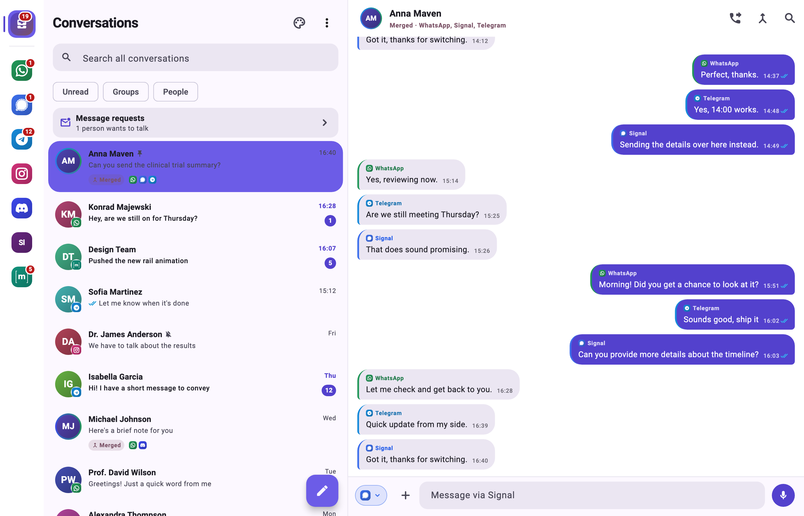
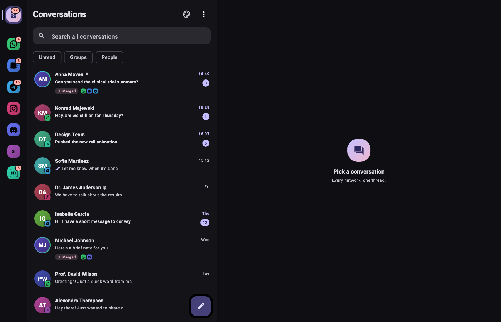
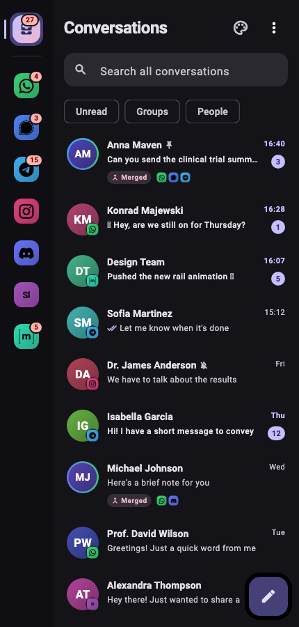
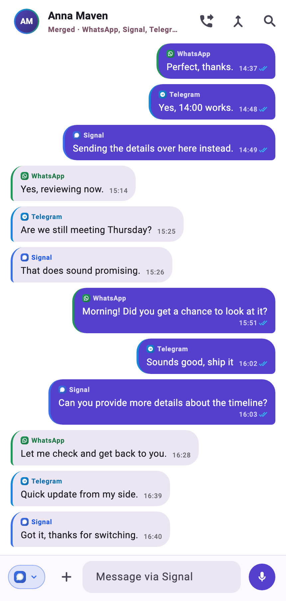
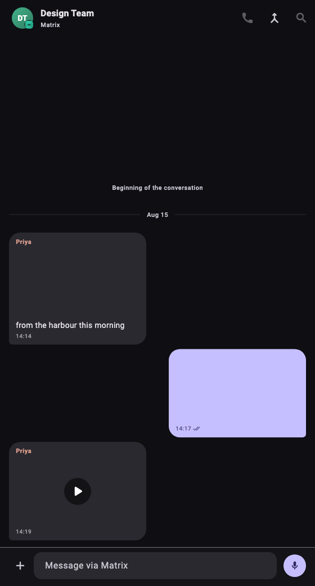

<p align="center">
  
</p>

<h1 align="center">Sennit</h1>

<p align="center"><b>Every conversation, one thread.</b></p>

<p align="center">
  A self-hosted, privacy-first messenger that weaves WhatsApp, Signal,
  Telegram, Google&nbsp;Messages, Mattermost, SMS and Matrix into a single
  inbox — on <i>your</i> homeserver, through <i>your</i> bridges, with
  nothing proxied through anyone else.
</p>

<p align="center">
  <a href="#features">Features</a> ·
  <a href="#screenshots">Screenshots</a> ·
  <a href="#install">Install</a> ·
  <a href="#getting-started">Getting started</a> ·
  <a href="#building">Building</a> ·
  <a href="#architecture">Architecture</a> ·
  <a href="#sennit-pro">Sennit Pro</a> ·
  <a href="#license">License</a>
</p>

---

Sennit is a [Matrix](https://matrix.org) client built from the ground up
around **bridged messaging**: pair it with a homeserver you run and
[mautrix](https://github.com/mautrix) bridges you control, and every network
your contacts live on becomes one conversation list — end-to-end encrypted
where the network allows it, and never routed through a third party.

No hosted middleman, no account with anyone, no message that ever touches
infrastructure you don't own.

## Features

**One inbox, really**
- 🧵 **Merged chats** — the same person on WhatsApp, Signal and Telegram
  collapses into a single thread. Replies ride the network the last message
  arrived on, or the one you pin. Identical names across networks merge
  automatically; everything else is a suggestion you decide.
- 🔀 Per-message network badges, per-network notification channels, and a
  network rail for one-tap filtering. Hide a work bridge from the combined
  view and reach it only from its rail entry.
- 📱 Android, iOS, macOS, Linux, Windows — with home-screen widgets, watch
  companions, share sheet integration and full desktop pointer UX
  (right-click menus, hover actions).

**Private by architecture**
- 🔒 End-to-end encryption via Matrix (vodozemac), with device verification,
  cross-signing and key backup.
- 🎙️ **On-device voice transcription** (Whisper) and **on-device semantic
  search** (embeddings + FTS5 + vector index) — or point both at endpoints
  you host. Nothing leaves your machines either way.
- 🤖 **AI reply suggestions** from your own OpenAI-compatible LLM (Ollama,
  llama.cpp, vLLM…), rendered as tappable chips on notifications.
- 🔕 Read receipts, typing indicators and presence — sent and shown, with a
  privacy switch for each.
- ⏳ **Disappearing messages**, per conversation: erase after an hour, a day or
  ninety days, counted from when a message arrived or from when you read it.
  Your own messages are redacted for everyone; the rest — text, photos and the
  bytes staged on disk — go from this device.

**Reliable in the real world**
- 🔔 Background delivery without Google: a built-in connection service
  (foreground service holding your own sync), or
  [UnifiedPush](https://unifiedpush.org)/ntfy if you prefer one distributor
  for all your apps. Messages decrypt on-device into full notifications
  with inline reply.
- 📅 Calendar invites negotiated inside chats (accept / decline / propose a
  new time), location sharing, polls, voice messages, PDF preview,
  scheduled sending, reminders, and Home&nbsp;Assistant / paperless-ngx
  integrations.
- 🛠️ An embedded [MCP](https://modelcontextprotocol.io) server, so your own
  agents can search and send through Sennit — guarded by scoped API keys.

## Screenshots

| Unified inbox | Dark |
|:---:|:---:|
|  |  |

| Mobile | Merged conversation | Media |
|:---:|:---:|:---:|
|  |  |  |

## Install

Desktop builds are attached to every
[GitHub release](https://github.com/bostrot/sennit/releases/latest). The
one-liners below fetch the latest one; set `VERSION=1.0.6` (or
`$env:VERSION = '1.0.6'` on Windows) first to pin a release. Prefer to read
before you pipe? The scripts live in [`tooling/install/`](tooling/install/).

<details>
<summary><b>macOS</b> (Apple silicon and Intel)</summary>

```bash
curl -fsSL https://raw.githubusercontent.com/bostrot/sennit/main/tooling/install/install.sh | sh
```

Installs the app into `/Applications` (or `~/Applications` if that isn't
writable). To do it by hand, download `*-macos.zip` from the release, unzip
it and drag the app into Applications.

</details>

<details>
<summary><b>Windows</b> (x64)</summary>

In PowerShell:

```powershell
irm https://raw.githubusercontent.com/bostrot/sennit/main/tooling/install/install.ps1 | iex
```

Installs for the current user into `%LOCALAPPDATA%\Programs` and adds a
Start menu shortcut — no admin rights needed. To do it by hand, download
`*-windows-x64.zip`, extract it anywhere and run `weft.exe`.

</details>

<details>
<summary><b>Linux</b> (arm64)</summary>

Releases currently ship an arm64 build only; on x64,
[build from source](#building) for now.

Install the runtime libraries first:

```bash
sudo apt install libgtk-3-0 libsecret-1-0 libsqlite3-0     # Debian / Ubuntu
sudo dnf install gtk3 libsecret sqlite-libs                # Fedora
```

Then:

```bash
curl -fsSL https://raw.githubusercontent.com/bostrot/sennit/main/tooling/install/install.sh | sh
```

Installs into `~/.local/share`, links the binary into `~/.local/bin` and adds
a desktop entry to your app launcher. To do it by hand, download
`*-linux-<arch>.tar.gz`, extract it and run `./weft`.

</details>

## Getting started

Sennit is the *client*. You bring:

1. **A Matrix homeserver** — [Synapse](https://element-hq.github.io/synapse/)
   or any spec-compliant server you run.
2. **Bridges** for the networks you want —
   [mautrix-whatsapp](https://github.com/mautrix/whatsapp),
   [mautrix-signal](https://github.com/mautrix/signal),
   [mautrix-telegram](https://github.com/mautrix/telegram),
   [mautrix-gmessages](https://github.com/mautrix/gmessages), and friends.
3. Sennit, signed into your account. It discovers your bridges, walks you
   through their login flows (QR codes included), and starts weaving.

A Docker Compose reference for the server side lives in
[`tooling/docker/`](tooling/docker/).

> **A note on third-party networks:** bridges automate your own accounts on
> networks whose terms of service may not allow it. That is your call to
> make, on your infrastructure — Sennit never touches those networks itself.
> Use a dedicated number where you can, and know that bans, while rare, are
> possible.

## Building

Sennit is a Flutter app in a Dart workspace of focused packages.

```bash
flutter pub get
flutter test                      # ~1000 unit, widget and golden tests
flutter run -d <device>           # Android, iOS, macOS, Linux, Windows
```

Release builds: `flutter build apk --release`, `flutter build macos
--release`, etc. For the two-Mac development loop (build on one, test on
another) see [`tooling/scripts/`](tooling/scripts/).

## Architecture

```
apps/weft/            The Flutter app: features, platform integration
packages/
  weft_domain/        Entities and rules, pure Dart, zero Flutter
  weft_matrix/        Matrix session, sync, E2EE, timelines, push
  weft_merge/         The identity graph: who is the same person where
  weft_search/        FTS5 + vector search + on-device embeddings
  weft_transcribe/    Speech-to-text adapters (local Whisper + endpoints)
  weft_store/         SQLite persistence, settings, secrets
  weft_bridges/       Bridge provisioning (mautrix bridgev2 API)
  weft_notify/        Notification decisions, rendering, policies
  weft_mcp/           The embedded MCP server
  ...
```

The pure-Dart packages carry the bulk of the test suite — merge scoring,
timeline interleaving, notification policy — and run without a device.
Golden tests pin every screen in light, dark and accessibility variants.

## Sennit Pro

All of Sennit is in this repository, and a build from source has every feature
switched on. The builds published on Google Play, the App Store and the
release page are free for messaging — every network, merged chats, calls, SMS,
keyword search, backups — and sell the parts that take the most work to build
and keep working as **Sennit Pro**, a single payment with no subscription:

- AI auto-replies, reply suggestions and the to-do assistant
- semantic search and voice-note transcription
- the MCP server
- the Home Assistant, paperless-ngx and shared-calendar integrations

Buying Pro is what pays for the project. If you would rather build it
yourself, that is what the licence is for.

## Contributing

Issues and pull requests are welcome — see
[CONTRIBUTING.md](CONTRIBUTING.md). Security reports: see
[SECURITY.md](SECURITY.md).

## License

[AGPL-3.0](LICENSE). You can self-host, modify and redistribute Sennit
freely; if you offer a modified Sennit to others over a network, share your
changes the same way.

The licence covers the code, not the name: a fork you publish needs its own
name and icon. See [TRADEMARKS.md](TRADEMARKS.md).
