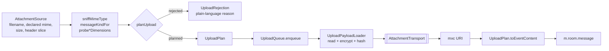
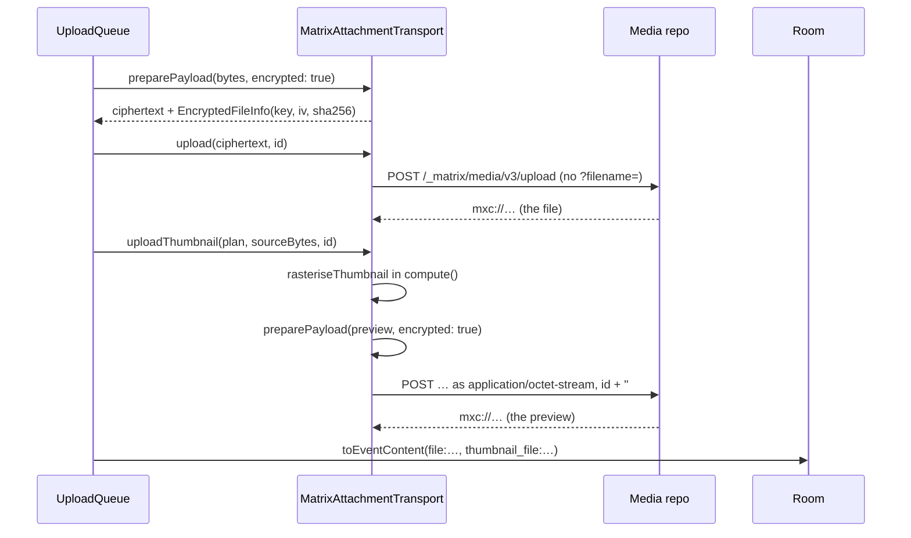

# Attachment Pipeline

Everything Weft decides about a file *before* a byte moves lives in
`packages/weft_attachments` — a pure-Dart workspace package with no Flutter, no
`dart:io` under `lib/`, and no codegen. The decisions are the subtle part
(what is this file really, which event shape does this room take, how many
sockets may be open at once), so they run under `dart test` in about a second
with no device and no homeserver. The parts that need a network or a rasteriser
sit behind an injected interface, and Phase 02 filled every one of them in:
`MatrixAttachmentTransport` moves the bytes, the repositories own the queue and
emit the events, and the UI renders the result. The encryption half of that is
[Encrypted media](#encrypted-media) below.

The package is three files and a barrel:

| File | Responsibility |
|---|---|
| `lib/src/detect.dart` | What is this file? Mime sniffing, `MessageKind`, header-only dimension probes |
| `lib/src/plan.dart` | What will we send? `UploadPlan`, `ThumbnailSpec`, the `m.room.message` content map |
| `lib/src/queue.dart` | How does it get there? `UploadQueue`, retry, cancellation, progress |
| `bin/plan.dart` | The one place allowed to touch `dart:io` — a CLI that prints the plan for a real file |



## Detection is sniff-first, not declaration-first

`sniffMimeType` resolves in a fixed order: **bytes → declared type → filename
extension → `application/octet-stream`**. The bytes win when they conflict with
the declaration, and that ordering is the whole point rather than a stylistic
preference.

An Android share intent is the reason. It routinely hands over `*/*`, or
`application/octet-stream`, or nothing at all, for what is plainly a JPEG.
Trusting it sends the photo as `m.file`, which renders as a paperclip with a
filename on every other Matrix client in the room — permanently, because the
event is already in the DAG by the time anyone notices. `_meaningfulMimeType`
therefore treats `*/*`, any `foo/*`, both octet-stream spellings, empty strings
and slash-less garbage as **no claim at all**, so a share intent's shrug can
never outrank a magic number.

Two refinements matter:

- **ZIP is refined, not overridden.** `docx`, `xlsx`, `pptx`, ODF, EPUB, APK and
  JAR are all literally `PK\x03\x04`. A sniff of `application/zip` is a true
  answer and a useless one, so here a declared or extension-derived type from a
  zip-based allowlist wins. Anything outside that list (a declared `image/png`
  over ZIP bytes) still does not.
- **The `ftyp` brand table is load-bearing.** Without it every iPhone photo
  files as `m.video`, since HEIC and MP4 share a container. `heic`/`heix`/`hev*`
  → `image/heic`, `mif1`/`msf1` → `image/heif`, `avif`/`avis` → `image/avif`,
  `M4A `/`M4B ` → `audio/mp4`, `qt  ` → `video/quicktime`, `3gp*` →
  `video/3gpp`, unknown → `video/mp4`.

### Totality is a contract, not an aspiration

Attachments arrive from outside the app's control: a file still being written by
a share intent, a truncated download, a deliberately malformed header. **Every
function in `detect.dart` is total** — malformed or truncated input returns a
fallback or null, never an exception. The suite enforces it rather than trusting
inspection: every fixture is fed to the sniffer and both probes at *every*
truncation length from zero upward, asserting `returnsNormally`.

The corollary is that null dimensions are normal, not an error.
`probeVideoDimensions` returns null for most real videos, because a non-faststart
MP4 puts its `moov` box at the *end* of the file, which is not in a header
slice. `planUpload` treats that as "size unknown", not "not a video".

### One header slice, one `stat`

`AttachmentSource` carries a *prefix* of the file plus the real `sizeBytes` from
the filesystem. A share intent can hand over a 400 MB video; nothing in this
package needs more than the first few kilobytes to decide what it is. The CLI
bounds its read at 64 KiB and takes the size from `stat`, and a test proves the
separation by planning a PNG padded past a megabyte: the event carries the full
on-disk `size` and the correct `w`/`h`, while the CLI reports having read only
64 KiB.

## The plain and encrypted event shapes are deliberately different

This is the part that renders as a broken attachment on every other client when
it is wrong, so it is worth being precise about.

**Plain room** — the mxc URI sits at the top level:

```json
{ "msgtype": "m.image", "body": "photo.jpg",
  "info": { "mimetype": "image/jpeg", "size": 91234, "w": 1400, "h": 900,
            "thumbnail_url": "mxc://…", "thumbnail_info": { "…": "…" } },
  "url": "mxc://…" }
```

**Encrypted room** — there is no top-level `url` at all; the URI lives *inside*
the key-material block:

```json
{ "msgtype": "m.image", "body": "photo.jpg",
  "info": { "mimetype": "image/jpeg", "size": 91234, "w": 1400, "h": 900,
            "thumbnail_file": { "key": { "…": "…" }, "iv": "…", "hashes": { "…": "…" },
                                "url": "mxc://…" },
            "thumbnail_info": { "…": "…" } },
  "file": { "key": { "…": "…" }, "iv": "…", "hashes": { "…": "…" }, "url": "mxc://…" } }
```

### What breaks when they are confused

- **Neither key present** → every client, Weft included, sees an attachment-less
  message. `weft_matrix`'s reader is literally
  `content['url'] is String || content['file'] is Map`; miss both and the
  attachment does not exist as far as the timeline is concerned.
- **Both present** → ambiguous. Receiving clients disagree about which to
  prefer, and a client that picks `url` in an encrypted room downloads
  ciphertext and renders garbage.
- **A plain `thumbnail_url` beside an encrypted `file`** → this is the one that
  actually leaks. The attachment is encrypted, but an unencrypted preview of the
  same image is now sitting on the homeserver's media repo, fetchable by anyone
  who can reach the URI. It looks correct in the timeline, which is what makes it
  dangerous.

So `toEventContent` **throws `ArgumentError`** on every mixed combination:
`encrypted` with no `file`, a `file` on a plain plan, and the same rule one
level down for `thumbnail_url` vs `thumbnail_file`. This is a deliberate
exception to the totality rule above — that rule governs *bytes from outside the
app*, whereas mixing the two shapes is a programming error by this package's own
caller, and a loud crash in a test beats a silent leak in a room. Both shapes are
asserted in the suite against the literal body of `weft_matrix`'s
`_hasAttachment`, so the writer and the reader cannot drift apart.

`EncryptedFileInfo` deliberately does **not** hold the mxc URI. Attachments are
encrypted before they are uploaded, so at the moment the key material exists
there is no URI to put in it — `toEventContent` injects one afterwards. That
ordering also makes it structurally impossible to emit key material on a
plain-room event.

### Round-tripping through `weft_matrix`

The write side must produce exactly what the read side already parses.
`messageKindFor` is the inverse of `messageKindFromMsgtype`; voice notes emit
**both** `org.matrix.msc3245.voice` and `org.matrix.msc1767.audio` because
`isVoiceMessage` accepts either, and an event must come back through `mapEvent`
as `MessageKind.voice` rather than `.audio` — the msgtype stays `m.audio`, since
what makes a voice note a voice note is the MSC key, not the msgtype.
`duration` is written to `info` as well, which is where `_durationMs` looks
first. `isVoiceNote` on `UploadPlan` is *derived* from `kind`, not stored: the
domain already draws that line in [[Merged-Timeline]]'s `WeftMessage`, and a
second flag saying the same thing could disagree with it.

### Thumbnails are a decision, not an image

Nothing here can decode pixels. `ThumbnailSpec` records *what to rasterise*:
longest edge 800px preserving aspect ratio, never upscaled, floored at 1px so a
4000x9 panorama cannot produce a zero-height preview; always `image/jpeg`;
suppressed below 64 KiB (a 40 KB photo *is* its own thumbnail — re-encoding it
doubles the upload for no gain) and for every non-visual kind. Null dimensions
still generate, falling back to an 800x800 bounding box, because that is the
normal case for video and treating it as "no preview" would silently drop
thumbnails for nearly every video sent.

## The queue bounds concurrency on purpose

`UploadQueue` runs **two** uploads at a time by default, and the cap is the
reason the class exists rather than an incidental setting.

Weft talks to homeservers people run themselves — a Synapse on a NAS behind a
domestic upstream. Sharing twenty photos from the system picker would,
unbounded, open twenty sockets and push twenty multipart bodies into a link that
can carry perhaps two at a time. Every upload then crawls, the progress bars
move in lockstep at a fifth of their real speed, the first photo lands no sooner
than the last, and a homeserver with a worker limit starts returning 429s that
the user reads as failures. Two saturates a typical upstream, lets the first
photos appear in the room while the rest are still going, and keeps the retry
budget for problems that are genuinely the network's fault.

The rest of the state machine follows from that:

- **Backoff quadruples — 1s, 4s, 16s** — rather than doubling, because the thing
  being backed off is one machine in someone's cupboard; `1s, 2s, 4s` mostly
  just retries into the same overload. The cap is 3 *attempts*, not 3 retries,
  so only the first two delays are ever waited at the default.
- **`retrying` does not hold a concurrency slot.** A task waiting out 16 seconds
  hands its slot back, returns to `queued`, and is re-dispatched keeping its
  position — so it is still the oldest thing waiting and goes first. Awaiting
  the backoff inside the run loop would let one flaky upload stall half the
  share.
- **`retryable` on `AttachmentTransportException` is load-bearing.** A 413 or a
  403 goes straight to `failed` on attempt one instead of making the user wait
  out five seconds of backoff for the same answer. It defaults to `true`, the
  opposite of `TranscriptionException`, because a wasted retry against your own
  homeserver is cheap where a wasted retry against a metered API burns quota.
- **Failure is terminal-but-recoverable.** A failed task keeps its place, its
  plan and its loader, so the UI can offer a retry rather than making the user
  find the file again. `clearFinished()` drops sent and cancelled tasks and
  *keeps* failures — those are the ones the user still has a decision about.
- **Cancellation is immediate locally, best-effort remotely.** A success that
  lands after the user pressed cancel is discarded rather than resurrecting the
  task.
- **Bytes arrive through an `UploadPayloadLoader`, per attempt**, not through
  `enqueue`. Holding twenty photos' bytes from enqueue to send would pin the
  whole share in memory. That is also what gives `UploadState.hashing` a real
  meaning: reading, encrypting and hashing the ciphertext is exactly the work
  between picking a task up and having bytes to send, and `UploadPayload`
  carries the `EncryptedFileInfo` beside the bytes because the `sha256` in it is
  the hash of *those* bytes.
- **Ordering promise, stated narrowly.** Tasks *start* in enqueue order.
  Completion order is the transport's business and is not promised — emitting
  the events in order is the sender's job in Phase 02. Per-room serialisation
  was considered and rejected: it would make the concurrency cap unobservable
  for a single-chat share, which is the exact case the cap exists for.

`updates` is a broadcast `Stream<List<UploadTask>>` carrying a fresh
`List.unmodifiable` per transition, so several widgets can render progress
without polling and a snapshot the UI is mid-build against cannot change
underneath it.

## The `AttachmentTransport` seam

```dart
abstract class AttachmentTransport {
  String get id;
  String get displayName;
  Future<String> upload(List<int> bytes, {
    required String mimeType,
    required String uploadId,
    void Function(int sent, int total)? onProgress,
  });
  void cancel(String uploadId) {}
  void dispose() {}
}
```

A bare interface with no `package:http` and no `dart:io` behind it, following
`TranscriptionProvider`'s shape exactly — stable `id`, `displayName`, one real
method, empty-default `dispose`, and a dedicated exception carrying `retryable`.

This is what keeps `lib/` free of I/O, and the payoff is concrete: the retry
schedule, the concurrency cap, FIFO ordering and cancellation are all asserted
against a `FakeTransport` in milliseconds rather than endured against a real
homeserver. The delay is injected too (`UploadDelay`), which is the only reason
the full three-attempt backoff sequence can be *asserted* as `[1s, 4s]` instead
of waited out.

`bytes` are already ciphertext for an encrypted room — encryption happens in the
payload loader, before the transport is ever called, so a transport never sees
plaintext it has no business seeing. `cancel` takes the same `uploadId` the
upload was given, because a cancel hook that cannot name what it is cancelling
is useless at concurrency 2. The queue does **not** dispose the transport: it
was injected, so the caller owns its lifetime, the same discipline
`weft_transcribe` applies to its `http.Client`.

### `bin/plan.dart`, the executable spec

```sh
dart run weft_attachments:plan path/to/photo.heic --encrypted
```

The CLI is the only `dart:io` in the package and exists so the pipeline can be
inspected against real files without an app. It prints the sniffed mime type,
the `MessageKind`, the dimensions readable from the header, the thumbnail
decision, and the pretty-printed event content, with obviously-fake
`PLACEHOLDER-…` key material so nobody mistakes CLI output for something real.
`--mime` simulates a share intent's claim so the sniffed-wins rule is
observable; `--voice` and `--duration-ms` stand in for the recorder; `--json`
pipes into `jq`. Exit codes are 0 planned, 1 usage or read error, 2 rejected.

## Encrypted media

This is the [[Encrypted-Media]] half of the pipeline: what actually happens to a
photo in an end-to-end encrypted room, which is every room Weft cares about.
`weft_attachments` describes the shape; `packages/weft_matrix/lib/src/upload.dart`
produces it.

**Encryption happens before the transport, in the payload loader.** A transport
never sees plaintext it has no business seeing, and `UploadPayload` carries the
`EncryptedFileInfo` beside the bytes because the `sha256` in it must be the hash
of *exactly* the bytes going up. The crypto itself is the SDK's `encryptFile`
(AES-CTR, vodozemac behind FFI) rather than anything hand-rolled — injected as an
`AttachmentEncryptor` typedef only so tests need no initialised binding.

### One attachment, two uploads

A photo in an encrypted room is **two** media items on the homeserver, encrypted
independently with their own key and IV:



Five rules hold this together, and each of them is a way it goes wrong:

- **The preview is encrypted too, and its URI goes in `thumbnail_file`.** A plain
  `thumbnail_url` beside an encrypted `file` is the leak described above: the
  attachment is safe and a legible copy of the same image is sitting on the media
  repo for anyone who can reach the URI. It looks completely correct in the
  timeline, which is what makes it dangerous.
- **The preview goes up as `application/octet-stream`.** Announcing `image/jpeg`
  over ciphertext tells the media repo what it is holding for no gain.
- **No `?filename=` is ever sent.** The body is ciphertext, but
  `holiday-with-sam.jpg` in the query string is not — and the name already
  travels inside the (encrypted) event.
- **The thumbnail's upload id is the attachment's plus `#thumbnail`.** Derived
  rather than allocated, so one `cancel` reaches both; two unrelated ids leave a
  cancelled photo still pushing its preview up.
- **A retry re-encrypts the file but does not re-upload the preview.** The
  repository records the thumbnail per task id — including a "tried, no preview"
  as a present null, so a video is not re-rasterised on every attempt — and a
  second copy of the preview never lands on the media repo.

`thumbnail_info` carries the size the preview **actually** came out at, not the
spec's. `ThumbnailSpec` falls back to an 800x800 box whenever the header could
not be probed, and writing that square into the event when the real preview is
800x450 makes receiving clients reserve the wrong shape and reflow it.

### Coming back down

The read path is the same asymmetry from the other side, and it is why
`ChatRepository` has two members instead of one:

- `attachmentBytes(roomId, eventId, thumbnail:)` — decrypt-and-download through
  the SDK, which forks on the room type inside that single call. It returns
  *bytes* rather than a URL because **an encrypted attachment has no fetchable
  URL at all**, and it holds the whole file in memory: the honest cost of E2EE,
  and not something a transport can be talked into avoiding.
- `attachmentLocation(roomId, eventId)` — non-null only for plain media, where a
  real mxc→http URL exists and `background_transport.dart` can stream a 200 MB
  video to disk without ever holding it. Spec v1.11 put media behind
  `Authorization: Bearer`, so the location carries headers too; without them a
  Save writes a 401 page into the user's Downloads folder.

`stageAttachment` picks between them once, materialises the file, and everything
after — the picture, the video decoder, Save, Share — reads that one file rather
than fetching the same video three times.

## Not yet handled

- **Video posters.** `package:image` is a still-image codec and cannot open an
  MP4, so a video is sent with no preview rather than a wrong one. Frame
  extraction is a platform capability, not a pure-Dart one; `uploadThumbnail`
  takes `sourceBytes`, so a caller that *has* a poster can already supply one.
- **HEIC dimensions** — deliberately not probed. They live in an `ispe` box
  behind the full item-properties tree, which is disproportionate for a header
  slice; the plan falls back to an 800x800 bounding box, as it does for video.
- **A live timeline.** `ChatView` reads its timeline once when the chat opens, so
  a photo that finishes uploading while the thread is on screen is not drawn
  until the chat is reopened — the upload bubble disappears with the task and
  nothing takes its place. The inbox tile updates, because it watches a stream.
  This is not in the attachment pipeline at all: it is how `ChatView` refreshes,
  and it applies equally to a text send in demo mode and to an event arriving
  from a sync. Found by running the app on macOS, not by any test.
- **iOS share-in.** Android's share target streams `content://` URIs to a staged
  copy and sends them through the composer's own upload path; the iOS equivalent
  needs a Share Extension target and signing.
- **Voice notes are recorded nowhere.** `isVoiceNote` is plumbed end to end and
  `m.audio` + the MSC keys round-trip correctly, but nothing in the app records
  audio yet.

## Tests

156 tests in the package — `detect` 68, `plan` 46, `queue` 32, `plan_cli` 10 —
part of the workspace's 592. Every fixture is built programmatically from byte
literals in `test/support/fixtures.dart`; **no binaries are checked into the
repo**, which is why a new format can be added to the sniff table without
sourcing a sample file.

The pipeline above it is covered where it lives: `weft_matrix`'s `upload_test`
and `mapping_test` for the transport and the incoming events, `apps/weft`'s
`attachment_send_test`, `attachment_bubble_test`, `media_viewer_test` and
`share_files_test` for the repositories and the UI, and eight golden images for
the bubbles and the pre-send sheet.

One test is not run by either — `apps/weft/integration_test/attachment_flow_test.dart`
drives the whole loop against a **real** engine on a real desktop:

```bash
cd apps/weft && flutter test integration_test/attachment_flow_test.dart -d macos \
  --dart-define=WEFT_DEMO=true
```

It exists because `flutter test` runs in a `FakeAsync` zone where no image ever
decodes and a decoded picture therefore has no hit area to tap: pick, preview,
upload, settle, tap, full screen is a sequence only a real event loop and a real
rasteriser can perform. Only the file picker is faked, because a real
`NSOpenPanel` is a modal a test cannot dismiss. Add
`--dart-define=WEFT_SHOT_DIR=…` to write a PNG of each step.
