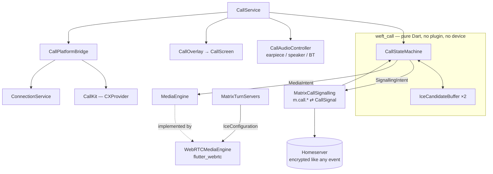

# Calling

A call is the one feature in Weft where being *nearly* right is indistinguishable
from being broken. A message that arrives a second late is a message; a call that
takes a second too long to answer is a missed call, and a call that drops the
first four ICE candidates connects perfectly at home and never once on mobile
data. So the design goal here is narrower than "make calls work": it is to make
every decision a call gets wrong provable without a phone, and to leave on the
device only the parts that genuinely need one.

That split is the whole architecture:

| Layer | Where | What it owns |
|---|---|---|
| Decide | `packages/weft_call/lib/src/state_machine.dart` | `CallStateMachine` — glare, expiry, party ids, hangup vs reject, renegotiation |
| Buffer | `packages/weft_call/lib/src/ice_candidate_buffer.dart` | Candidates with nowhere to go yet, in both directions |
| Speak | `packages/weft_matrix/lib/src/call_signalling.dart` | `m.call.*` ⇄ `weft_call`'s events, including through encryption |
| Relay | `packages/weft_matrix/lib/src/turn_servers.dart` | TURN credentials, their expiry, and the sentence when there are none |
| Drive | `apps/weft/lib/services/call/call_service.dart` | The active call, the deadlines, one call at a time, audio routing |
| Capture | `apps/weft/lib/services/call/webrtc_media_engine.dart` | `flutter_webrtc`, the microphone, the camera |
| Show | `apps/weft/lib/features/call/` | Full-screen call, incoming sheet, minimised bar, the app-bar button |
| Ring | `ios/Runner/CallManager.swift`, `android/.../call/` | CallKit and `ConnectionService`, through one method channel |

The interesting file has no WebRTC in it and the file with WebRTC in it makes no
decisions — the same shape [notifications](notifications.md) takes, and for the
same reason.

## Glare: lowest call id wins, lexically

Two people press call at the same moment and each gets an `m.call.invite` while
its own is still ringing. Exactly one call may survive and both sides must pick
the same one **without exchanging another message about it** — there is no
protocol step for the decision, only a rule both ends already know.

The rule is a lexical comparison of the two call ids, **lowest wins**
(`_resolveGlare`). Glare is only considered when the existing call is
`outgoingRinging` *and* in the same room; an invite arriving in any other live
state is busy, not glare, and is refused with `m.call.reject` and `user_busy`.

Three details are load-bearing and each is pinned by a test that will fail if
someone "simplifies" it:

- **Lexical, not numeric.** `'10' < '9'` as strings and `10 > 9` as numbers, so
  a rule that parsed ids as integers would disagree with the far end exactly
  when both clients happen to generate digits. The comparison matches the Matrix
  SDK's (`call_session.dart:212-240`), which is what Element runs.
- **The loser hangs up with `unknown_error`.** MSC2746 defines no reason code
  for glare. Sending an invented one would be self-consistent and would read as
  a protocol error to everything else; `unknown_error` is what the SDK sends.
- **Both parties run the same rule on the same two ids**, so the outcome is
  symmetric by construction rather than by negotiation. The glare loser's hangup
  is emitted *before* its teardown intents — order that the test suite asserts,
  because a teardown that raced ahead would close the buffers the hangup still
  needs.

Being merely deterministic is not enough here. The far end is usually Element,
and a deterministic rule that disagrees with it produces two surviving calls or
none.

## Candidate buffering, in both directions

Candidates routinely beat the description they belong to. The caller starts
trickling the moment gathering begins, so `m.call.candidates` can land before
`m.call.answer` has been processed; and locally, candidates are gathered before
the invite is on the wire, when the far end does not yet know the call exists.
Both directions need a queue, and `IceCandidateBuffer` is used for both.

What makes this worth a class rather than a list is the shape of the failure.
Dropping early candidates does not break a call outright: it discards the host
and server-reflexive candidates and keeps whatever arrives later, which on the
same Wi-Fi still connects. The symptom is "calls work at home and nowhere else"
— indistinguishable from a missing TURN server, and usually diagnosed months
later. So the buffer counts what it throws away (`droppedCount`) and that count
is the one thing worth logging about ICE.

It dedupes by value (peers resend candidates after a reconnect, and adding the
same one twice is at best wasted work), caps at 256 (a real call gathers a
handful; hundreds means a buffer is never being flushed, which in a long-lived
call service is a leak), and flushes **in order**.

> [!NOTE]
> The suite caught a real instance of this arriving by the back door. `_endCall`
> closes both buffers, and `_startIncoming` did not reset them — so the *second*
> incoming call of a session, the ordinary case where one call ends and the next
> arrives, inherited two closed buffers and silently discarded every early
> candidate. `_startIncoming` now begins with `_resetCallState()`.

## Why the media engine is injected

`MediaEngine` is an interface — `createOffer`, `createAnswer`,
`applyRemoteDescription`, `addCandidate`, `setMute`, `setVideo`, `switchCamera`,
`dispose`, plus `localCandidates` and `connectionState` streams — and
`CallStateMachine` knows nothing else about media. Three things follow, and the
third is the reason:

1. **`weft_call` has no Flutter dependency**, so it runs under `dart test` in
   the pure-package CI group and its 122 tests take about a second.
2. **`flutter_webrtc` is confined to one app file.** `WebRTCMediaEngine` is 377
   lines and contains no call logic; the single judgement in it,
   reading a codec summary out of the SDP, is split into `sdp_codecs.dart` so it
   can be tested without a peer connection.
3. **A 60-second invite timeout is asserted in a microsecond.** The clock is
   injected too (`CallStateMachine({clock})`), and `Tick` is the only thing that
   expires anything. So are the call service's three deadlines — 30 s ICE, 20 s
   reconnection grace, 15 s renegotiation — which are `DateTime?` fields checked
   on a tick rather than `Timer`s, driven in tests by one `StreamController`
   event and a `DateTime` addition.

Audio *routing* is deliberately not in the engine. `CallSession.speakerOn` is
recorded on the session and the OS is driven by `call_audio.dart`, whose whole
policy is one pure function, `resolveCallAudioRoute`. Four routes rather than a
speaker boolean, and the user's explicit choice wins **only while the route it
names still exists** — that single condition is the entire answer to "headphones
unplugged mid-call": the choice is not cleared, it stops matching, the call falls
back to the earpiece, and re-plugging restores it.

## TURN is the user's homeserver's problem, and it must say so

Weft hosts nothing. A relay comes from `/_matrix/client/v3/voip/turnServer` on
whatever homeserver the user signed in to, and **a self-hosted Synapse very
often has none** — an out-of-the-box install answers `200 {}`, which is the
"configured, but no relay" case rather than an error.

Without a relay, two peers behind different NATs never exchange media. The call
places, rings, is answered, and then nothing is heard: the exact failure a user
cannot diagnose and cannot report usefully.

`MatrixTurnServers.configuration()` therefore **never throws** — a call with no
relay still works on one network, so this is a warning to show rather than a
reason to refuse to dial — and reduces the outcome to four values, because the
failures need four different sentences:

| `TurnAvailability` | What happened | Consequence |
|---|---|---|
| `available` | `uris` and credentials, with a ttl | Ordinary call |
| `notConfigured` | 404, or 200 with no `uris` | Same-network only; warn |
| `unauthorised` | 401 | The session is not usable for VoIP; warn |
| `unreachable` | Anything else, or no answer | Same, plus it may be transient |

`IceConfiguration.warning` is carried on `CallServiceState`, which is the value
the call screen reads — not logged. That is the whole point: the Matrix SDK
catches this case, logs it at verbose level and returns `[]`, which is precisely
how a self-hosted account ends up with calls that work at home and nowhere else
with nothing on screen to explain it.

Two gaps in the SDK's own handling are closed here rather than inherited:
credentials are **refetched two minutes before expiry** (`kTurnRefreshMargin`)
instead of being fetched once and kept for the life of the process, and
concurrent callers share one in-flight request.

**No public STUN fallback is substituted.** A hard-coded `stun.l.google.com`
would hand every user's IP addresses to a third party they never chose, and it
would not fix the failure anyway — STUN cannot traverse a symmetric NAT, which
is the case TURN exists for. An empty server list still allows a call over the
local network, which is exactly what the warning says.

## Matrix-native only, said once and shown plainly

Bridged networks do not carry calls. A WhatsApp conversation in Weft is a room on
the user's own homeserver whose remote party is a bridge ghost; an
`m.call.invite` addressed to it reaches a puppet that will never answer. So the
call button is disabled for those conversations, with a sentence rather than a
grey glyph.

The predicate is `callAvailabilityFor(chat, contact:)` in
`packages/weft_call/lib/src/call_availability.dart`, defined once and shared by
the app bar and the tests. It returns a `CallReady(CallTarget)` or a
`CallBlocked`, and there are three blockers rather than one boolean because they
are three different sentences:

- **`bridged`** — no Matrix-native leg. *"WhatsApp and Signal can't carry calls —
  Weft calls over Matrix."*
- **`group`** — more than two people. `weft_call` is 1:1 only.
- **`unknownPeer`** — a Matrix room the identity graph has not resolved a person
  in. There is a room to call and nobody to name as `invitee`, and inventing one
  would ring whoever else is in the room.

The test is **not** "does this chat have a Matrix room id" — a bridged chat has
one too. It is `chat.sourceFor(ChatNetwork.matrix) != null`, which is sound
because `networkForRoom` classifies a room as `matrix` only when no bridge state
event and no ghost-localpart heuristic claims it. `CallTarget` carries both the
room (from the chat, which is what the inbox already resolved) and the peer (from
the merged contact, which is the person) because neither implies the other: see
[[Multi-Device]] for why an identity and a room are separate questions in Weft,
and [[Notifications]] for the same merged-identity resolution applied to the
shade.

## One call at a time, enforced twice

`CallStateMachine` refuses a second **incoming** invite with `m.call.reject` and
`user_busy`, so the far end stops ringing immediately instead of waiting out the
invite lifetime. `CallService.placeCall` refuses a second **outgoing** one with
`CallStartFailure.busy`, which is a sentence for the button that was just
pressed. Neither is redundant.

The busy reject is the one intent addressed to a room that is *not* the active
call's: that invite arrived in another conversation, and sending its reject to
the call in progress would leave the second caller ringing. `_roomForCall`
remembers where each invite arrived.

## Signalling, and what encryption does not change

Call events are ordinary room events and are encrypted like any other. Nothing
special is needed inbound — the SDK decrypts before `onCallEvents` — and outbound
goes through `encryption.encryptGroupMessagePayload` + `client.sendMessage`
rather than `room.sendEvent`, because the latter puts a local echo in the
timeline and one call sends dozens of `m.call.candidates`.

What *is* new is the negative case: a `ToDeviceEventDecryptionError`, or an event
still typed `m.room.encrypted`, is dropped. Reading a `call_id` out of ciphertext
would invent a call.

Four rules in the mapping worth knowing:

- **Our own echo is dropped, other devices are not.** An event whose sender is us
  *and* whose `party_id` is our device id is discarded — otherwise our own invite
  comes back down `/sync` and looks like the far end calling. Another device of
  the same user is a genuine second party; `m.call.select_answer` exists for it,
  and a `select_answer` naming another party ends our call with
  `answeredElsewhere`.
- **`unsigned.age` beats `origin_server_ts`.** Expiry compares a *server*
  timestamp against a *local* clock, so a device an hour fast would silently drop
  every incoming call. `age` carries no clock.
- **Video is read out of the SDP, not out of a flag.** MSC2746 has none;
  `sdpOffersVideo` looks for an `m=video` section and ignores one with port `0`,
  which is how a downgrade is expressed.
- **One deliberate wire difference from the SDK:** `m.call.reject` carries a
  `reason`. The SDK sends none and MSC2746 defines none, but "they were on
  another call" and "they declined" are different sentences and nothing else
  distinguishes them. An unknown key is ignored by other clients.

## System integration: three platforms, one state machine

Outbound platform calls are **a diff over the state stream, not a set of call
sites**: `CallPlatformBridge.follow(service.states)`. Nothing in `CallService`
calls the bridge, which is the design — a future transition cannot forget to tell
CallKit, because nothing tells CallKit, the state does. `sync()` is idempotent,
which is what makes it safe to drive from a stream that fires on every candidate.

| Platform | Incoming surface | Notes |
|---|---|---|
| iOS | CallKit (`CXProvider`), PushKit VoIP push | Hand-written; no notification is ever posted for a call |
| Android | Self-managed `ConnectionService` + full-screen-intent notification + `phoneCall` foreground service | Survives Doze; appears in the system call log |
| macOS / Linux / Windows | The in-app sheet and a notification | No system integration by design |

Five judgements that are easy to get wrong:

1. **Answer and decline are one CallKit button and two Matrix events.**
   `CXEndCallAction` cannot distinguish them, so iOS always sends `onHangUp` and
   `CallService` decides — `hangUp` on a ringing call already emits
   `m.call.reject`. Android *can* distinguish and does. Element shows the
   difference as "declined" against "call ended", so it is not cosmetic.
2. **`CXAnswerCallAction` is fulfilled before Dart answers.** CallKit times an
   action out after five seconds; answering involves a homeserver round trip and
   a peer connection. A timed-out answer tears the call down underneath a state
   machine midway through accepting it.
3. **The push path is inverted from every other bridge.** A PushKit VoIP push
   must be answered with `reportNewIncomingCall` before the handler returns, or
   iOS terminates the app and eventually stops delivering VoIP pushes at all. So
   the native side reports the call with whatever the push carried and Dart
   catches up with a `CXCallUpdate`; a 20-second grace ends a reported call Dart
   never confirms.
4. **The Android calls channel is created in Kotlin as well as in Dart, and the
   importance is a literal.** Telecom can bind `WeftConnectionService` before
   Dart has ever run, Android fixes channel importance at creation, and
   `IMPORTANCE_MAX` (5) is not `NotificationManager.IMPORTANCE_HIGH` (4) — using
   the framework constant would silently downgrade the channel
   [notifications](notifications.md) created a phase early precisely to avoid that.
5. **Mute is an input from Telecom, not a mirror.** A self-managed `Connection`
   can read `CallAudioState.isMuted` and cannot set it, so `updateCall` moves the
   system's hold button and leaves its mute button alone. CallKit has no such
   limit and is driven through `CXSetMutedCallAction`.

## Tests, and what they cannot establish

| Suite | Tests | What it pins |
|---|---|---|
| `packages/weft_call/test/` | 122 | State machine, glare from both sides, candidate ordering, negotiation, availability, value semantics |
| `packages/weft_matrix/test/call_signalling_test.dart` + `turn_servers_test.dart` | 57 | The wire in both directions, encryption's negative case, the four TURN outcomes |
| `apps/weft/test/call_*.dart` + `goldens/call_golden_test.dart` | 105 + 10 images | Service deadlines, one-call-at-a-time, every control's effect, both incoming shapes |
| `apps/weft/integration_test/call_test.dart` | 3 | A real call between two accounts on a real homeserver |

Every terminal assertion checks a `CallEndReason` *and* its `wireReason`, because
half of these behaviours are only visible to the far end: a call ended by
`m.call.reject` shows as declined in Element and one ended by `m.call.hangup`
shows as ended, and no local state tells them apart.

### Verified on 2026-08-19

| Checked | Result |
|---|---|
| `flutter build macos` | **Built** `build/macos/Build/Products/Release/weft.app` (146.0 MB) |
| `flutter build apk` | **Built** `app-release.apk` (189.8 MB), with the README's `RUSTC` pin and `JAVA_HOME` from Android Studio's JBR |
| `flutter build ios --no-codesign` | **Fails in `pod install`**, unchanged from Phase 04 and unrelated to calling — `whisper_ggml` requires iOS 15.6 and the project targets 13.0. See [ADR-002](../decisions/adr-002-ios-signing-handoff.md) |
| `CallManager.swift` against the iOS SDK | **Type-checks** (`swiftc -typecheck -target arm64-apple-ios13.0`), one deliberate warning: `.allowBluetooth` is renamed only in the newest SDK, so adopting the new spelling would make the file uncompilable on every earlier Xcode |
| Android call Kotlin | `:app:compileDebugKotlin` clean, `:app:processDebugMainManifest` merges |
| A real call, `@alice:localhost` → `@bob:localhost` | **Placed, rung, answered, connected and hung up**, in an encrypted room on the Synapse from `tooling/docker` |
| TURN on that Synapse | **`notConfigured`** — `200 {}` from `/_matrix/client/v3/voip/turnServer`, which is the out-of-the-box answer; the warning was raised and carried on `CallServiceState` |

The real call is `integration_test/call_test.dart`, and what it does and does not
prove is worth stating precisely. **Real:** two logins, an encrypted room, every
`m.call.*` event going out through `MatrixCallEventSink` with a live Megolm
session, arriving down the far end's `/sync`, parsed back by
`MatrixCallSignalling` and driving a second production `CallService` — invite →
ring → answer → candidates in both directions → connected on both sides → hangup
read as `remoteHangup`, plus a decline read as `remoteReject`. **Not real:** the
media. Both engines are fakes, so the SDP crossing the wire is a fixture and no
audio is captured. Opening a microphone needs a TCC grant only a person at the
keyboard can give, and a test that stops on a permission dialog is worse than one
that says plainly what it did not do.

So the honest summary is: **the signalling is proven against a real homeserver,
including through encryption; the media path is proven only against a fake peer
connection.** Nothing in this phase has rung an actual phone. Compilation
establishes that CallKit and `ConnectionService` are used correctly, not that a
handset lights up — and with no relay on the test homeserver, the first real call
between two networks will be the first test of the warning this design spends so
much effort producing.

## Not yet handled

- **`m.call.replaces` (transfer) and `m.call.asserted_identity`** are not
  modelled. Hold is a state plus a renegotiation; transfer is nothing.
- **`sdp_stream_metadata`** is not consulted; video presence is read from the
  SDP.
- **Group calls.** `weft_call` is 1:1 by construction, and a group conversation
  is refused as a `group` rather than half-supported.
- **VoIP push on iOS** needs a second APNs credential that cannot be an auth key.
  `CallPlatformBridge.voipTokens` publishes the token and nothing consumes it, on
  purpose — see [ADR-002](../decisions/adr-002-ios-signing-handoff.md). Everything else works: any call
  while Weft is in the foreground, and every call on Android.
