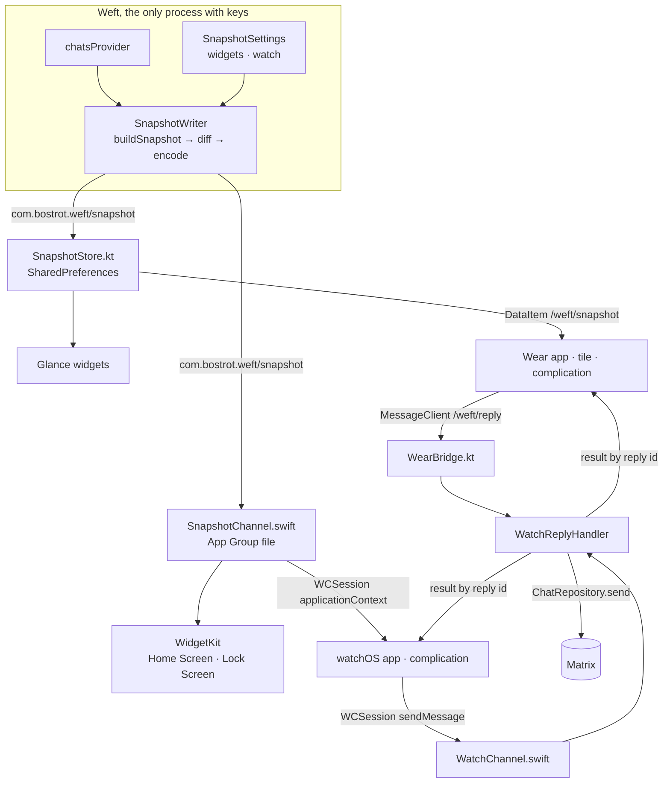
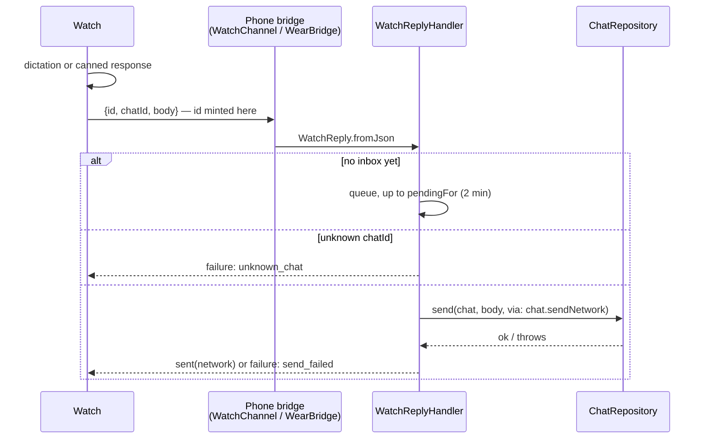

# Companion Surfaces

Four surfaces outside the app draw Weft's inbox: Android home screen widgets
(Glance), Apple home screen and Lock Screen widgets (WidgetKit), a watchOS app
with a complication, and a Wear OS app with a tile and a complication. They look
like four features. They are one decision with four renderers.

The decision is not a layout. **None of these processes can decrypt a Matrix
room** — so the only question that matters is what the app is willing to write
*outside* the encrypted store for them to read, and that is a privacy question
with a switch on it. Everything else follows.

| Layer | Where | What it owns |
|---|---|---|
| Gate | `packages/weft_snapshot/lib/src/policy.dart` | `SnapshotPolicy` — enabled, two preview flags, per-network exclusion, row cap |
| Decide | `packages/weft_snapshot/lib/src/snapshot.dart` | `buildSnapshot`, `InboxSnapshot`, `SnapshotRow` — the whole redaction in one function |
| Wire | `packages/weft_snapshot/lib/src/codec.dart` | `SnapshotCodec` — versioned, size-capped, total on decode |
| Store the gate | `apps/weft/lib/services/snapshot/snapshot_writer.dart` | `SnapshotSettings` — the two surface switches, `fromStore`/`writeTo` |
| Drive | `apps/weft/lib/services/snapshot/snapshot_writer.dart` | `SnapshotWriter` — the inbox subscription, the diff, the logout clear |
| Reply | `apps/weft/lib/services/snapshot/watch_reply_handler.dart` | `WatchReplyHandler` — the pending queue, chat resolution, the result report |
| Choose | `apps/weft/lib/features/settings/surfaces_screen.dart` | The opt-in, the per-network rows, the live preview of a real row |
| Android write | `android/…/widget/SnapshotChannel.kt`, `SnapshotStore.kt` | `com.bostrot.weft/snapshot`, the shared prefs file, the update broadcast |
| Android draw | `android/…/widget/WeftInboxWidget.kt`, `WeftUnreadWidget.kt` | Two `GlanceAppWidget`s, five states, the deep-link intent |
| Apple write | `ios/Runner/SnapshotChannel.swift`, `ios/Shared/SnapshotContainer.swift` | The App Group file, `WidgetCenter.reloadAllTimelines` |
| Apple draw | `ios/WeftWidget/` | One directory, two targets (iOS + macOS), four families plus the accessory |
| watchOS | `ios/WeftWatch/`, `ios/Runner/WatchChannel.swift`, `ios/Shared/WatchProtocol.swift` | The watch app, its complication, `WCSession` both ways |
| Wear OS | `android/wear/`, `android/…/wear/`, `android/shared/…/WearProtocol.kt` | The watch APK, the tile, the complication, the Data Layer both ways |
| Parse (×3) | `SnapshotCodec` · `SnapshotPayload.kt` · `SnapshotPayload.swift` | One writer, three hand-written readers |

## Why no surface holds a session

This is the constraint everything else is built around, and it is four separate
impossibilities that happen to have the same answer.

- **A WidgetKit extension** is a separate process with a separate bundle id, no
  keychain access group by default, and a memory ceiling low enough that
  [[Share-Surfaces]] refuses to link the Flutter engine into an *extension that
  only copies a file*. A widget is woken repeatedly, on the system's schedule,
  and one that gets killed often enough stops being scheduled at all — which the
  user reads as a blank rectangle they eventually delete.
- **A Glance provider** has no Flutter engine. It is a `RemoteViews` tree
  composed in a WorkManager job; there is no Dart in the process to call.
- **A watch app** has neither, on either platform, and it also has no keys. It
  is not paired to a homeserver; it is paired to a phone.
- **All four would have to advance ratchet state** in a process the app cannot
  see, which is how a device ends up unable to decrypt its own messages later.
  [[Notifications]] refuses background decrypt in the notification service
  extension for exactly this reason, and that extension does far less.

So the split is the same one [[Share-Surfaces]] and [[Attachment-Pipeline]]
take: the *decision* is pure Dart, tested under `dart test` with no device, and
the platform code is a renderer with no judgement in it.

`packages/weft_snapshot` is that decision. The three parsers on the far side —
`SnapshotCodec` in Dart, `SnapshotPayload.kt`, `SnapshotPayload.swift` — read a
payload whose every string has *already* been filtered, rendered, truncated and
linked. There is no second filter past the process boundary and there cannot be
one, because two of the three parsers are in languages no test in this
repository runs.

**The `INTERNET` permission is absent from `android/wear/src/main/AndroidManifest.xml`.**
That is the whole architectural claim written as a manifest entry: the watch
cannot reach a homeserver even by mistake.

## The snapshot is a privacy decision

A widget row is message content sitting outside the encrypted store, on a home
screen, in a file the OS and any device-level backup can read. So it gets the
treatment remote transcription and remote embedding get, and for the same
reason — see [Privacy](../../README.md#privacy):

- **Off by default.** `SnapshotSettings.off` is what an unconfigured install
  reads as, and it is also what a *failed* settings read falls back to. A gate
  that opens when it cannot find its own configuration is not a gate.
- **Useful once switched on.** Names and message previews default to on when a
  surface is enabled: a widget of anonymous, wordless rows was the first
  version, and it was useless. Both stay one switch away from off, and with
  names off a row is titled by its networks rather than a shared placeholder.
- **One plain sentence** saying what turning it on costs, before the switch, as
  a hint on the tile's own semantics node — `PrivacyNotice` and
  `PrivacyGatedTitle` from `settings_section.dart`, the same two widgets the
  endpoints screen uses. A reader arriving by heading jump never visits the top
  of a screen, so the warning has to be attached to the control rather than
  placed above it.
- **Per-network exclusion**, on `ChatNetwork.id`.
- **A live preview** built by calling the real `buildSnapshotRow`, so what the
  screen promises cannot drift from what the writer does.

### Two preview flags, not one

`weft_notify` renders previews-off as hiding the message *body* while keeping
the conversation title and the sender — Android's "hide sensitive content", not
iOS's "hide previews" — and documents the stricter reading as a separate second
step. `SnapshotPolicy` mirrors that split exactly:

| Flag | Off means |
|---|---|
| `includePreviews` | no `preview`. The title, the unread count and the timestamp stay. |
| `includeSenderNames` | the title reads `Conversation`, the sender is dropped, and so is the avatar. |

The avatar travels under `includeSenderNames` rather than under a flag of its
own because for a DM the avatar *is* the other person's face. A row showing it
beside a title reading "Conversation" has redacted nothing.

**An excluded network drops the whole conversation, merged ones included.** A
merged row has one title and one preview for several legs; there is no way to
render "the Signal half" of it, and excluding a network has to mean those
messages do not leave the encrypted store.

### Two switches, one payload

The settings screen has separate **Home screen widgets** and **Watch** switches,
because a home screen is read by whoever is standing next to it and a wrist is
not. `SnapshotPolicy` has one `enabled`, derived as `widgets || watch` — writing
the same rows twice would double the disclosure without adding a surface.

The two surface flags travel **beside** the payload (a `SharedPreferences`
boolean on Android, a shared `UserDefaults` boolean on Apple), never inside it.
`SnapshotCodec` stays the only writer of a format two hand-written parsers
already read, and the flag is checked *before* the rows are, fail-closed on both
platforms. That produces a state the Dart side cannot express and both renderers
must: **a payload the file has and this Home Screen may not draw**, which is a
watch-only user.

The gate is enforced at the transport too, not only at the renderer. With the
watch switched off, the phone publishes the flag *without* the payload on both
platforms. A payload sitting on a wrist that may not draw it is a payload a
future bug can render, and the point of the opt-in is that those rows never left
the phone.

### Five states, case for case

Both hand-written renderers answer the same five questions with the same five
answers, because two renderers that disagreed about which states exist would be
worse than either:

| State | What the surface found | What it says |
|---|---|---|
| signed out | no payload — the writer deletes on logout | sign in on your phone |
| switched off | `enabled: false` | where the switch is |
| watch-on, widgets-off | a payload, and a surface flag that is false | where the switch is |
| stale / unreadable | `isStaleAt(now)`, or a payload that will not parse | open Weft on your phone |
| ready | rows, or none | the inbox, or "you're all caught up" |

Stale and unreadable share one message deliberately: a twelve-hour-old snapshot
and a half-written one are the same fact to the person reading them.

`kSnapshotStaleAfter` is 12 hours. **WidgetKit gets the stale flip exactly** and
Glance cannot: a timeline is a list of instants, so `getTimeline` returns a
second entry scheduled at precisely `generatedAt + kSnapshotStaleAfter` carrying
the `unavailable` state, and the widget changes on the second with the extension
never woken. Glance only re-reads on a wake, so its `updatePeriodMillis` of an
hour gives it twelve chances to notice inside the same window.

### The diff, and the two things "only when it differs" does not cover

`watchChats` emits on everything — a read receipt, a typing indicator, an unread
count moving. The written payload changes on a small fraction of those, and each
write is a Binder transaction plus a full widget recomposition. So `SnapshotWriter`
compares against the last write and returns without touching the platform when
they match, the same rule `ShareShortcutService` follows in [[Share-Surfaces]].

Two corrections were needed for it to work at all:

1. **`generatedAt` is excluded from the comparison.** It moves on every build, so
   a byte comparison would find every tick different and the diff would never
   fire. The cost is paid back by `rewriteAfter` — 3 hours, a quarter of
   `kSnapshotStaleAfter` — so an unchanged inbox cannot drift into the stale
   state while the app is in the user's hand.
2. **The surface flags are part of the key.** Turning the watch off while the
   widget stays on changes nothing in the payload and everything about who may
   draw it.

`clear` is wired to `loggedOut` and `softLoggedOut` through the same
`sessionStateProvider` listener that takes the launcher's share targets away.
There is no app-lock signal in Weft to wire it to; the Lock Screen accessory
renders while the *device* is locked, and what it may show was decided by the
policy before the lock. `privacySensitive()` marks exactly the disclosures — the
row title, the preview, the accessory's most-recent name — so the system's
redacted rendering makes the same split on a locked screen that
`includePreviews` / `includeSenderNames` make on the writing side. The empty
states are deliberately *not* marked: they are about the app's own configuration,
and redacting them would hide the only text explaining why the widget is empty.

## The codec, and why a stale extension must not crash

This is the one place `weft_snapshot` inverts a rule `weft_share` states.

`kStagedShareFormatVersion` is documented as being present for diagnosis rather
than for gating: the Share Extension ships *inside* the app bundle, so a reader
older than its writer cannot exist. **A widget or watch process breaks that
premise.** It is started and kept by the OS on its own schedule and can be held
across an app update, so a reader older than its writer is the ordinary case
rather than an impossibility.

So `decode` **accepts a higher version**, reads what it recognises, and flags it
as `isFutureVersion`. It does not refuse. An unread count and a chat id mean the
same thing in every version this format will have, and the alternative is worse
than showing slightly less: a widget extension that crashes is one the OS stops
scheduling and the user eventually deletes.

Refused outright, in every case without throwing: null, empty or blank input; a
payload past `maxBytes`, which is what a partially overwritten file looks like
and which the reader is the wrong process to try to hold; anything `jsonDecode`
cannot parse; a root that is not an object. Everything else **degrades**:

- a missing `generatedAt` reads as the epoch, which makes the snapshot maximally
  stale and sends the surface to "open Weft on your phone" — the right answer
  for a payload that cannot say when it was written;
- a missing `enabled` reads as true, since the switched-off payload is the one
  that states it;
- a missing `totalUnread` falls back to the sum of the visible rows rather than
  to zero, because a payload saying "0 unread" beside rows carrying unread
  counts reads as messages having been marked read;
- rows that are not usable are **skipped individually** rather than taking the
  payload with them.

`rows` is read through a `_listOrEmpty` helper rather than `as List?`, for the
reason `ShareStagingCodec` learnt the hard way: a wrong-*typed* value raises a
`TypeError`, which is not a `FormatException` and sails past the `try` around
`jsonDecode`. Three of the four readers here are hand-written with no compiler
checking these key names, so a wrong type is exactly as likely as a wrong length.

The same rule binds the two non-Dart parsers. Neither uses `Codable` or a
generated decoder: a synthesised `init(from:)` throws on the first mismatched
field, which turns "one row arrived malformed" into "the widget has no payload".
`SnapshotPayload.swift` is `JSONSerialization` and per-field defaults for
exactly that reason.

### The size cap has a mechanism behind it

`kMaxSnapshotBytes` is **64 KiB**, and each reader is the memory-constrained
side of its own boundary: Wear OS rejects a `DataItem` above 100 KB outright,
an Android widget update crosses a Binder transaction with a ~1 MB budget
*shared with every other transaction in flight*, and a WidgetKit extension that
decodes megabytes stops being scheduled.

`encode` drops rows from the end until it fits rather than emitting a payload
the reader will refuse — half a list is a widget, a rejected payload is a blank
rectangle — and `decode` enforces the cap again, because the writer is the
process with memory to spare. `totalUnread` is **not** recomputed as rows are
shed: it never counted only the visible ones, and the Lock Screen accessory and
the complication show exactly that number.

`kDefaultSnapshotRowCap` is 16, twice the largest renderer.
`kMaxSnapshotPreviewLength` is 80 **graphemes**, two lines of a large widget
family. The grapheme part is the divergence from `weft_notify._truncate`, which
cuts on UTF-16 code units: in a notification shade a split surrogate pair is a
momentary broken glyph in a row that scrolls away; in a widget it is a fixed box
rendering it on every refresh for as long as that message is the newest one.

### Four facts the surfaces must never re-derive

1. **`Chat.id`** as the row key — `merged:<contactId>`, or a room id. Minted in
   `matrix_chat_repository.dart`, not in `weft_merge`. Re-deriving it splits a
   merged conversation into two rows counting half the unread each.
2. **`chatDeepLink(chatId)`** for the tap target, built in Dart and consumed by
   Glance's `actionStartActivity(Intent)` and WidgetKit's `Link`. The whole id is
   one percent-encoded segment; one escape apart and the link opens nothing.
   `weft://` with no segments is the inbox — the plausible `weft://inbox` is the
   spelling `WeftLink.parse` returns null for.
3. **`ChatNetwork.id`** for exclusions, and **`brandColor`** as an int in the
   payload's `palette`, once per payload, so no platform keeps a second colour
   table. `unreadLabel` (`99+`) and `link` are formatted in Dart for the same
   reason.
4. **`Chat.sendNetwork`**, which is what a watch reply rides — and the reason the
   reply handler must reject a chat id it does not recognise. See below.

**No avatars cross to Android.** A row's `avatar` is an `mxc://` URI and neither
widget process has a session to authenticate a media fetch with; sixteen decoded
bitmaps would also cross the Binder transaction the payload cap exists to
protect. Merged-ness is carried by the *number* of network dots and by the
accessibility description — the two non-colour signals `ChatTile`'s
never-colour-alone rule sets as the floor.

## The watch reply round trip

A watch may *display* a snapshot and it may *ask* for a message to be sent. That
is the entire capability surface, and the second half is `WatchReplyHandler` —
the only place either companion can cause a write.

Six decisions hold it together, each answering a way a reply can go wrong
silently.

**The shapes invert with the direction, and that is not stylistic.** The
snapshot travels as a `DataItem` / `updateApplicationContext` — *state*, which
must survive the watch being out of range and be current-or-knowably-stale. The
reply travels as a message — an *event*, which must not be replayed onto a node
that reconnects tomorrow.

**Both transports deduplicate by content, which is a trap here rather than a
feature.** `SnapshotWriter`'s three-hourly rewrite of an unchanged payload exists
precisely so a surface does not drift into its stale state, and both platforms
would have swallowed it. Hence an `updatedAt` stamp on both sides.

**The reply id is minted on the watch**, because both transports can deliver
twice: `WCSession.sendMessage` fails when the phone is unreachable and the watch
retries through `transferUserInfo`, which is queued and *will* arrive, so a reply
sent at the edge of reachability arrives once by each road. Wear's
`MessageClient` has the same shape. The handler answers a redelivered id with the
**original result** rather than sending a second message. Sending one message
twice is the failure this path exists to make impossible.

**An unknown chat id is rejected, never guessed.** A merged chat reverts to a
bare room id when a leg is left, so a well-formed snapshot row can outlive the
conversation it names — and a widget or watch process can hold that row for
hours. The alternative to rejecting is picking some *other* conversation to send
a private message into.

**The queue waits for an inbox rather than failing fast.** A reply can be what
starts the app, so `listen` fires before the chat list exists; answering
`unknownChat` there would tell the user their message failed for a conversation
that is fine. `pendingFor` is 2 minutes, aged on `refresh` rather than on a
timer, `maxPending` is 16, and everything pending is failed back on sign-out
because the next session is a different account.

**Every accepted reply gets a report, including the ones where nothing was
sent** — which is the "visible rather than silent" requirement as a property
rather than a hope. Six failure ids, spelled identically in Dart, Kotlin and
Swift:

| Id | Raised by | Means |
|---|---|---|
| `unknown_chat` | handler | the row outlived its conversation |
| `not_signed_in` | handler | signed out while the reply was queued |
| `send_failed` | handler | `ChatRepository.send` threw; reported once, not retried |
| `timed_out` | handler | waited out `pendingFor` with no inbox |
| `overflowed` | handler | `maxPending` reached; the queue refuses rather than growing |
| `app_not_running` | platform | a `WearableListenerService` or `WCSession` delegate woke a process with no Flutter engine in it |

The watch's own send timeout is a seventh outcome and reports a **nil** failure,
because it genuinely does not know why. Both watch string tables fall through on
an unrecognised id rather than switching exhaustively: the ids are a contract
with a phone app that updates on its own schedule, and watches are updated late.

### An App Group does not span devices

The phase brief asked for the watch to read "the same App Group snapshot", and
that is not achievable — `group.com.bostrot.weft` on a watch is a container *on
the watch*. The payload travels by `updateApplicationContext` and the watch
writes it into its own container through the same `WeftSnapshotContainer` the
phone uses.

That is not a workaround. The complication is a **separate process** the system
wakes on its own schedule with no reference to the app, and a container is the
only thing both can read. The same shape falls out on Wear OS for a different
reason: the tile and the complication are woken with a bare `Context`, so the
`DataItem` is cached into `SharedPreferences` on arrival.

**The complication has no variant that can carry a name**, on either platform. A
watch face is on whenever the wrist is up, in front of whoever is opposite. That
is the `privacySensitive()` split made structurally rather than by a modifier.

## Three renderers, and what does not cross the boundary

`weft_design` cannot cross the process boundary — every token in it is a Flutter
type, and Glance and WidgetKit have no engine. The precedent for carrying a
design value out is `ChatNetwork.brandColor`, held as an `int` so the package
stays Flutter-free. Everything else is duplicated deliberately and documented,
the way `ShareContainer.swift` already does for paths.

The two platforms then take **opposite** answers on colour, and both are right:

- **Android restates a twenty-four-slot Material scheme.** Below Android 12
  there is nothing to defer to. `res/values/colors.xml` and
  `res/values-night/colors.xml` hold `ColorScheme.fromSeed(0xFF6C5CE7)` for both
  brightnesses, read out of the running app through a throwaway Flutter test
  rather than hand-mixed. Resource-backed `ColorProvider`s mean the launcher's
  configuration resolves light/dark, so there is no `isSystemInDarkTheme` branch
  in the Kotlin. Above API 31 `GlanceTheme.colors` is the wallpaper's dynamic
  palette and none of it is read.
- **Apple keeps only the accent.** iOS has semantic colours already correct in
  light, dark, Increase Contrast and the tinted Home Screen; reaching past them
  to paint a literal grey is how a widget becomes the one rectangle that ignores
  the user's display settings. The unread badge is the seed's indigo as a
  dynamic `UIColor`/`NSColor` provider rather than an `@Environment(\.colorScheme)`
  branch, because WidgetKit re-renders an archived hierarchy in appearances the
  provider never saw.
- **Both watch surfaces are dark-only.** `UIColor(dynamicProvider:)` and
  `userInterfaceStyle` do not exist on watchOS and Wear has no light mode. The
  reason under both is that an OLED pixel showing black is off.

Two other rules the renderers share:

**Preview images are shape studies, not screenshots.** Android's `previewImage`
and the Wear tile's preview drawable are compiled into the APK and shipped to
everyone, so they cannot show real conversations — and drawing plausible fake
ones would have the widget picker teaching the user to expect names before they
have agreed to any leaving the encrypted store. The network dots in them use
real `ChatNetwork.brandColor` values. WidgetKit's `placeholder(in:)` follows the
same rule; its `getSnapshot(in:)` deliberately does not, because unlike a PNG in
a bundle it is generated live on the user's own unlocked device while they are
the one adding the widget, and "Widgets are off" is the most useful thing a
gallery can tell someone who has not opted in.

**`Link` per row, `widgetURL` for the surface.** `widgetURL` is one URL for the
whole widget, so setting it per row means the last one silently wins and every
row opens the same conversation. On `systemSmall` the system honours *only*
`widgetURL`, which is why that family keeps three rows and drops the preview: it
is a glanceable summary that opens the inbox, not a menu. The Wear tile makes
the same call for the same reason.

## What compiling found that reading would not

Every one of these was a build failure, and none of them is visible in a careful
review. They are recorded because the next target in either project meets the
same ground.

**Android.** `actionStartActivity(Intent)` lives in
`androidx.glance.appwidget.action`, not in `androidx.glance.action` where the
`ComponentName` and `Class` overloads are — and only the `Intent` overload can
carry a URI, which every tap on this surface is. `defaultWeight()` is a member of
`RowScope`/`ColumnScope`, not a `GlanceModifier` extension.
`androidx.glance:glance-material3` does **not** expose Compose Material 3 to its
consumers, so the documented `ColorProviders(light:dark:)` construction needs
`androidx.compose.material3` added by hand — which drags Compose UI, Foundation
and Animation into an APK whose entire interface is Flutter. The artifact was
dropped and the palette built from `colorProviders(…)` over colour resources
instead, leaving `glance-appwidget` as the only new dependency.

**Apple.** `macos/Runner.xcodeproj` has a **project-level** base configuration
(`Runner/Configs/Debug.xcconfig` → `Flutter-Debug.xcconfig` →
`Pods-Runner.debug.xcconfig`), and a project-level xcconfig reaches every target
in the project — so the widget extension inherited Runner's entire CocoaPods
link line and failed with `ld: framework 'CocoaAsyncSocket' not found`.
`WeftWidget-macOS.xcconfig` resets `OTHER_LDFLAGS`, `OTHER_SWIFT_FLAGS` and the
three search paths, which is the Podfile comment's "this extension links
nothing" enforced rather than asserted. `ios/Runner.xcodeproj` has no
project-level base configuration and needs no equivalent. Separately,
`UIColor(dynamicProvider:)` and `UITraitCollection.userInterfaceStyle` are
**unavailable on watchOS**, so a shared tokens file stops compiling the moment it
joins a watch target.

**Both pbxprojs allocate object ids from the same `5F…` space and the macOS one
is denser.** Reusing `5F60000000000000000000FD` — already its "Embed Foundation
Extensions" phase — produced `-[PBXCopyFilesBuildPhase buildPhase]: unrecognized
selector` and a project Xcode refused to open.

**A latent parser bug, worth naming because it is silent.** The palette's values
are opaque ARGB, so `0xFF25D366` is 4 280 818 534 — half a billion past
`Int.MAX_VALUE`. Kotlin's `JSONObject.optInt` returns the *fallback* for those,
without complaint, and every network glyph would have come out the same default
grey. Read as `Long` and narrowed. Swift has no equivalent trap here (`Int` is
64-bit) but narrows to `UInt32` anyway, so the colour shifts are total by
construction.

## What the device found that no test did

The Android widgets were placed on an emulator and **never re-read the
snapshot.** `WeftInboxWidget.provideGlance` and `WeftUnreadWidget`'s read
`WeftWidgetState.read(...)` into a local *before* `provideContent`. But
`provideGlance` runs once per Glance **session** — at bind, or after the host
process dies — while `ACTION_APPWIDGET_UPDATE`, the only thing
`SnapshotStore.notifySurfaces` broadcasts on every write, recomposes the content
of a session that is already running.

So the state was read exactly once and never again. Switching **Message
previews** on left both widgets drawing the payload from whenever they were
placed, indefinitely, and the only thing that ever refreshed them was killing the
app. The old comment asserted the opposite — "the system may compose the returned
content more than once" — which is true, and is precisely why the read had to
move *in* rather than stay out. Both now read inside `provideContent`.

Two things worth knowing before repeating that run. Glance's `SessionWorker` is a
WorkManager job and on an emulator it can take **20–30 seconds** to land; a
10-second wait reads as "still broken", which is why this took three passes to
characterise. And `adb shell am force-stop` is not a usable stand-in for a killed
app: the first widget tap after one is swallowed, because force-stop cancels the
app's `PendingIntent`s, and that is a state no user can produce.

## Tests

**101 in `weft_snapshot`** — `snapshot_test.dart` 62, `codec_test.dart` 39, over
a `test/support/fixtures.dart` with a pinned `now`, in the shape `weft_notify`
and `weft_share` use. **83 across the four app-level files** —
`snapshot_writer_test.dart` (29), `watch_reply_test.dart` (28),
`surfaces_screen_test.dart` (20) and `goldens/surfaces_golden_test.dart` (6 tests,
12 images). No Flutter in the package suite, no device in any of them.

Three habits worth carrying to the next surface:

- **Redaction is asserted against the whole serialised payload**, not against the
  field that was cleared. `expect(json, isNot(contains('otter')))` is what catches
  a body reaching a surface through some *other* key later. The surface flags get
  the inverse assertion — they must **not** appear in the payload, because
  `SnapshotCodec` is the only writer of a format two hand-written parsers read.
- **The truncated-payload test walks every prefix** of a real two-row payload
  rather than one hand-picked cut, the same rule `staging_test.dart` settled on.
  The writer can be suspended between any two bytes, so in production they all
  eventually happen.
- **The grapheme test asserts its own fixture bites.** `hasUnpairedSurrogate` on
  the naive `substring(0, 80)` must be true before the assertion that
  `truncatePreview` leaves it false means anything. It covers a skin-tone
  modifier and a four-person ZWJ family.

Two fixture facts the code corrected, both now pinned:

1. `chatDeepLink` leaves `!` unescaped — `Uri.encodeComponent` treats it as a
   legal path character, and only the colon is escaped. The wire-contract test
   pins the exact string `weft://chat/!room%3Aexample.org`, which is what the
   hand-written Swift and Kotlin parsers actually receive.
2. `WatchReply.receivedAt` comes off `clock.now()` rather than the suite's pinned
   instant, and it is the one place these tests part company with the package
   fixtures. A reply stamped months ago in a process running today arrives well
   past `pendingFor`, so every send in the first draft reported `timed_out` — and
   would have gone on "passing" the moment an assertion happened to agree.

**One real defect the app suite found**, in `WatchReplyHandler._drain`: the
`pendingFor` ageing check was inside the `chats == null` branch, so it only ever
fired for a reply that met *another reply* while still queued. A reply that
waited out its two minutes and then met a sign-in was **sent** — an hour-old "on
my way" arriving in a conversation it no longer describes, to a watch that
reported it timed out long before. The check now runs before the inbox is
consulted, which is a no-op on the normal path.

### Verified on a device

Android, on an API 36 emulator, from `RUSTC=… flutter build apk` (193 MB
release, three ABIs cross-compiled):

| Checked | Evidence |
|---|---|
| Both providers registered | `dumpsys appwidget` lists both receivers |
| Both widgets place from the picker | with their preview images — shape studies, no fabricated names |
| The list renders the real inbox | five rows, the merged one included |
| The tile counts correctly | **21 unread** — the four unread badges in the app (3+1+12+5), not the rail's per-network 27 |
| Redaction is right at every setting | names off → five rows titled "Conversation"; previews on → the body with no sender prefix; both on → "Anna Maven (Signal): …" |
| Taps route to the right conversation | row four → Dr. James Anderson (Instagram), row one → the merged `merged:anna` with its three-network timeline, row two → Konrad Majewski, the unread tile → the inbox |
| A deep link survives a cold start | `libflutter.so` loading and `Fully drawn +4s576ms` in the log for one of them |
| The switched-off state | the demo APK opens its stores at `:memory:`, so a restart genuinely resets the gate and both widgets drew "Widgets are off — Open Weft and turn on Home screen widgets under Widgets & watch" |

`flutter build macos` succeeds with `WeftWidget.appex` embedded in
`weft.app/Contents/PlugIns/`. `xcodebuild -target WeftWatch -sdk watchsimulator`
produces a `WeftWatch.app` with `PlugIns/WeftWatchComplication.appex` inside it
and the right bundle ids in both `Info.plist`s. `./gradlew :wear:assembleDebug`
produces a `wear-debug.apk` with all four components in the merged manifest.

## Not yet handled

- **No paired device on either platform**, so **no reply has made the round trip
  over a real radio.** The emulator answers `Wearable.API is not available on
  this device`, which the bridge logs and survives. Everything either watch does
  has been exercised against a fake gateway and compiled against a real
  toolchain; neither is the same as a wrist.
- **No iOS build of any kind.** `flutter build ios --no-codesign` does not reach
  Xcode: `pod install` fails first on `whisper_ggml`'s 15.6 floor against
  Runner's `IPHONEOS_DEPLOYMENT_TARGET = 13.0`. Reproduced with this entire
  directory stashed, so it predates the phase — see
  [ADR-002](../decisions/adr-002-ios-signing-handoff.md#outstanding-the-ios-deployment-target-is-your-call).
  The iOS *embed* step is therefore the one thing here not exercised end to end.
- **The macOS App Group is a comment, not an entitlement**, and the macOS
  Runner does not request one either — so both processes see
  `containerURL(...) == nil` and the extension draws its signed-out state.
  Deliberate: an App Group entitlement cannot be ad-hoc signed, so adding it
  would make `flutter build macos` fail for anyone without the team's
  certificate. [ADR-002](../decisions/adr-002-ios-signing-handoff.md#phase-10--widgetkit-watchos-and-wear-os)
  has the exact string.
- **No JVM or XCTest suite for the two hand-written parsers.** `SnapshotFormat.decode`
  and `SnapshotPayload.decode` are the pieces on those sides with branches rather
  than layout, and there is no test source set in either module to put them in
  without standing one up. Worth doing when one exists.
- **No avatars on any surface.** Resolving an `mxc://` URI needs a token no
  companion process has — the same limit [[Share-Surfaces]] records for the iOS
  extension's picker, and with the same possible fix (the host app pre-resolving
  faces into the shared container).
