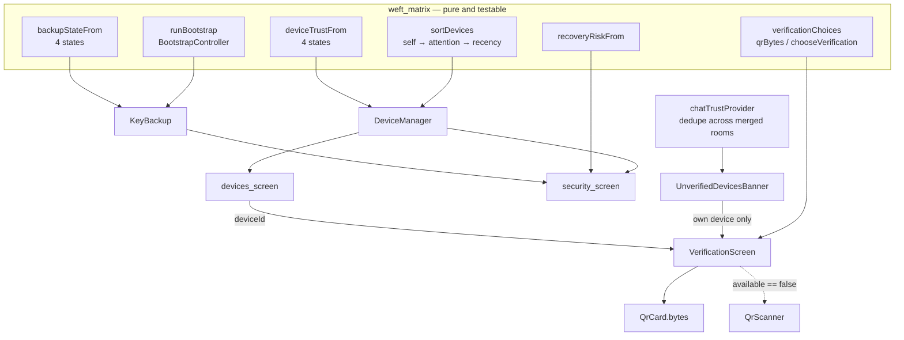
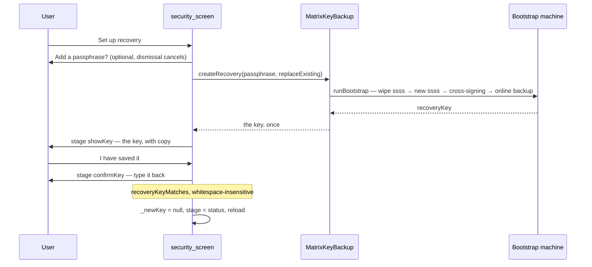

# Multi-Device

Matrix keeps no copy of the keys that decrypt your messages. That single fact is
the whole subject of this document, and every screen below exists to make it
arrive *before* it is needed rather than the morning after a phone goes in a
canal. A homeserver cannot hand your history back the way every other messenger
the user has met would, and an account with no key backup and no second signed-in
session is one dropped device away from losing everything, permanently, with
nobody to appeal to.

Login and interactive device verification were built in Phase 01 and are not
re-described here. What this track adds is the rest of session management: a
list of the account's devices with actions on each, cross-signing and
server-side key backup behind a recovery key, an unverified-device warning in
the conversation where it matters, and the session-transfer QR code.

The split is the one every other subsystem takes. Everything decidable without a
homeserver is a pure function or a small value type in `weft_matrix`, tested
under `flutter test` against a fake; everything that is a round trip sits behind
an interface so a screen is not exercisable only against a live Synapse.

| Layer | Where | What it owns |
|---|---|---|
| Classify | `packages/weft_matrix/lib/src/devices.dart` | `DeviceTrust`, `deviceTrustFrom`, `sortDevices`, `RoomTrust`, `roomTrustFrom` |
| Act on sessions | same file | `DeviceManager` / `MatrixDeviceManager` — list, rename, sign out, UIA re-auth |
| Classify backup | `packages/weft_matrix/lib/src/key_backup.dart` | `KeyBackupState`, `backupStateFrom`, `RecoveryRisk`, `recoveryRiskFrom` |
| Drive bootstrap | same file | `BootstrapController`, `runBootstrap` — the seven-state walk that mints a recovery key |
| Act on backup | same file | `KeyBackup` / `MatrixKeyBackup` — status, `createRecovery`, `restore` |
| Choose a method | `packages/weft_matrix/lib/src/verification.dart` | `verificationChoices`, `verificationQrBytes`, `chooseVerification` |
| List | `apps/weft/lib/features/settings/devices_screen.dart` | The rows, rename, sign-out-others, the re-auth prompt |
| Recover | `apps/weft/lib/features/settings/security_screen.dart` | The four-stage recovery-key flow and the restore path |
| Warn | `apps/weft/lib/features/chat/unverified_devices_banner.dart` | The strip above the composer |
| Verify | `apps/weft/lib/features/auth/verification_screen.dart` | The one flow, now with two entrances and the QR arms |
| Render a code | `apps/weft/lib/features/components/qr_card.dart` | The white card, extracted from the bridge login screen |
| Read a code | `apps/weft/lib/features/components/qr_scanner.dart` | A seam with nothing behind it, deliberately |

## Four states, twice, for the same reason

Both classifiers in this track have one more member than a status line would
suggest, and in both cases the extra member is the one that matters.

**`DeviceTrust`** is `verified` / `unverified` / `blocked` / `noKeys`. "Not
verified" and "has never uploaded encryption keys" look identical in a list and
mean opposite things: the first is a device the user can and should verify, the
second *cannot* be verified and cannot read encrypted messages either. Hence
`needsAttention` excludes `noKeys` — a badge demanding action with no action
behind it is a demand with nowhere to go. `blocked` wins over `verified` in
`deviceTrustFrom`, because the SDK reports a device with a broken
self-signature as blocked and such a device must never be presented as
trustworthy on the strength of an older verification still on record.

**`KeyBackupState`** is `absent` / `locked` / `outOfDate` / `upToDate`.
`locked` — a backup exists that this device cannot open — is the load-bearing
one:

> `absent` and `locked` render identically in a status row and need opposite
> actions. `absent` wants a setup flow that mints a new recovery key; `locked`
> wants the key the user already has. Collapsing them sends half the people who
> hit it into a flow that **replaces the backup holding their history**.

`backupStateFrom` takes three booleans rather than a client, so the rule — and
the order it tests them in, which is the whole content of it — is checkable
without a homeserver, a key store or a network. One ordering decision is worth
naming: a cached secret with no server version is `absent`, not `outOfDate`.
Account data claiming a backup exists after its version was deleted describes
something that is gone, and the only honest thing to say is that nothing is
backed up.

`MatrixKeyBackup.status` reads the backup info **uncached**. The SDK's cache is
five minutes deep, which is long enough to show "no backup" to somebody staring
at the screen they just made one on. Only a `MatrixException` (`M_NOT_FOUND`)
is read as "no backup"; a transport failure is not an answer and is allowed to
propagate.

## What is lost with no backup and no second device

`RecoveryRisk` weighs the backup state against how many *other* sessions the
account has, and the third member is the reason the type exists:

| Risk | State | What a lost device costs |
|---|---|---|
| `none` | A backup exists on the server | Nothing |
| `otherDevicesOnly` | No backup, another session signed in | Nothing, if that session is used to verify the replacement before it too is lost |
| `unrecoverable` | No backup, nothing else signed in | **The history, permanently.** Nobody can undo it |

`KeyBackupState.locked` counts as `RecoveryRisk.none`. The server is holding the
keys, and whether the user still has their recovery key is a question no client
can answer for them — overstating it as a risk would put a red box on the
account of everyone who has ever set a backup up.

The security screen names the `unrecoverable` case in as many words rather than
leaving it to be inferred from an absent tick, and that state is one of the
golden scenes: `absent` with zero other devices is the copy that earns the
screen. The device count comes from the same `DeviceManager.devices()` list the
devices screen shows, not from a second count of its own.

## The recovery-key flow

Four stages on one screen — `status`, `showKey`, `confirmKey`, `restore` — held
in a field rather than as four routes. The setup steps are only meaningful in
order, and a key sitting on a route the user can navigate back to is a key that
can be reached again after they said they had saved it.

The key is shown **once** and is never retrievable again — this is the only
moment it exists outside the key store — so the confirm step asks the user to
type it back rather than merely tick a box. `recoveryKeyMatches` normalises
whitespace on both sides, because the SDK emits the key spaced in blocks of four
and a key that has been through a clipboard has usually lost that.
`formatRecoveryKey` puts the blocks back, since an unbroken 48-character string
is the form people mistype.

Backing out of the optional-passphrase prompt cancels the entire setup. It is
the last step before keys are minted and uploaded, so treating a dismissal as
"no passphrase, carry on" would set recovery up on a shrug.

### The bootstrap driver always mints fresh, and that is deliberate

`runBootstrap` walks the SDK's bootstrap state machine and answers `true` to
every wipe question after the first. That reads like recklessness and is the
opposite:

> The machine only offers to *keep* existing cross-signing keys or an existing
> backup **after migrating their secrets into the new storage key** — a path
> this driver never takes. So reaching either "keep" arm would leave an account
> whose public keys claim a private half that is now unreachable. Once a new
> storage key exists, wiping and re-minting is the only honest answer.

`replaceExisting` is where the user consents to that, and it gates only
`askWipeSsss` — the *first* wipe question, which is the one that means "this
account already has recovery set up". The refusal therefore happens **before the
first call**, so a user who says no has had nothing touched;
`'existing recovery is refused, and nothing is touched'` pins exactly that.
Above it, the screen puts a red-buttoned confirmation in front of the replace
path spelling out that the old key stops working and every other device must be
verified again.

Five remaining bootstrap states are reachable only by choosing to keep existing
storage, which the driver never does, so arriving at one means the machine
changed underneath us — they throw a `KeyBackupException` saying nothing was
changed rather than guessing. The walk is capped at 16 steps (the real sequence
is at most seven states) so a controller that stops advancing fails loudly
instead of spinning.

`BootstrapController` is an interface over `enc.Bootstrap` for one reason: three
of the machine's states destroy something, picking the wrong arm does not throw,
and a fake can assert which calls happened in which order where a live Synapse
cannot be asked to prove a negative.

`createRecovery` needs no `onUpdate` callback — every transition it makes is
synchronous or awaited, so the state has settled by the time each call returns
and a callback would only be a second, racier way to read it. (This replaced
`WeftMatrixSession.bootstrapEncryption`, which had no callers and could not have
worked: it started the machine without awaiting it and returned nothing, so a
caller had no key to show and no way to know it had finished.)

One sharp edge for future callers: `createRecovery` throws **synchronously**
where `status` and `restore` return a failed future — it is not `async`, and
`_encryption` is read before `runBootstrap` is called. Every current call site
is `try`/`await`, so all three are caught; a `.catchError()` caller would not
be.

### Restore

`restore` opens the account's default SSSS key, unlocks it with the recovery key
or passphrase, calls `maybeCacheAll` — which caches the cross-signing secrets
too, and is what makes this device *trusted* rather than merely able to read old
messages — and then pulls the room keys down.

A wrong key surfaces as `enc.InvalidPassphraseException` and is translated into
a sentence that mentions the key is case-sensitive. That assertion lives at the
*screen* rather than in `weft_matrix`, deliberately: reaching the exception
needs a client with live encryption, which is unavailable without the crypto
libraries and unreachable behind an in-memory test database. The part with
user-visible consequences — the sentence arrives, and the step does not advance
— is what `security_screen_test.dart` pins.

Every failure in this file is a `KeyBackupException` whose `message` is
user-facing text rather than a log line, for the same reason
`DeviceActionException` is: the alternative is rendering a Dart exception at the
exact moment somebody is being asked to trust the app with their history.
`MatrixKeyBackup` refuses in words when `client.encryption` is null — the shape
a session has when the crypto libraries fail to load — and `status` matters most
there, because an unreadable session answering `absent` would offer to set up a
backup for an account that may already have one.

## The devices screen

An access token is invisible. A session left behind on a lent laptop or an old
phone keeps reading messages forever, and nothing in a messenger surfaces that
except a list. So each row leads with the two facts that let someone recognise a
session they did not mean to leave open — where the homeserver last saw it, and
when — plus its verification state, with the current device marked.

`sortDevices` orders by **self, then attention, then recency, then device id**.
Recency alone would be wrong: the device a user most needs to find is either the
one in their hand or the unverified one that appeared last Tuesday, and that one
is by definition not at the top of a recency list. The device id is the final
tiebreak so the order is *total* — a list that reshuffles between two loads
because two devices share a timestamp reads as something having changed when
nothing has.

### UIA re-auth is hand-rolled and deliberately narrow

Signing a device out invalidates a token, so the homeserver demands
re-authentication. `MatrixDeviceManager.signOut` calls `deleteDevices`, catches
the `MatrixException`, reads the **first stage of each advertised flow** — which
is correct precisely because no auth was sent, so nothing is completed — and
retries with `AuthenticationPassword`.

Only `m.login.password` is presentable. Anything else is a
`DeviceActionException` carrying a sentence the screen shows verbatim, pointing
the user at their server's own account settings. A cancelled prompt is
`ReauthCancelled` and is **silent**, because nothing happened. Multi-stage flows
are not supported; `client.uiaRequestBackground` is the escape hatch if that
ever becomes necessary.

### A real Flutter bug, found here and still live elsewhere

Building a `TextEditingController` at a call site and disposing it when
`showDialog` returns throws *"A TextEditingController was used after being
disposed"* on the next frame — the dialog's **exit animation** is still
rebuilding the field. `TextPromptDialog` (now in `settings_section.dart`, shared
by both settings screens) owns its controller and disposes it with the route.

The same pattern is **still live** in `mcp_screen.dart` (`label`) and
`bridges_screen.dart` (`url`), and is not scheduled by any task in this phase.

## The warning goes in the conversation

`UnverifiedDevicesBanner` is a strip above the composer, not a settings row and
not a dialog. The moment worth interrupting is the one before a message is
typed, not a screen someone visits once a year; and it must be neither
dismissible-and-forgotten nor able to stop anyone sending. It renders nothing at
all when there is nothing to say, so the chat view places it unconditionally and
never reasons about whether a room is encrypted.

`chatTrustProvider` is a family over the chat id rather than a field on `Chat`,
because trust is the one fact about a conversation that comes from the key store
instead of the timeline — putting it on `Chat` would drag E2EE state through
every repository that builds one, including the demo repository. Two properties
of it are load-bearing:

- **Devices are deduplicated across a merged chat's rooms.** This account's own
  device is a member of every encrypted room in the merge, so summing per-room
  counts would report three unverified devices where there is one. `trustOfRooms`
  keys on `userId|deviceId`.
- **Failures resolve to `RoomTrust.none`.** The banner is an advisory, and a
  key-store hiccup must not put a red bar over a chat that is fine.

Blocked devices are **not** counted by `roomTrustFrom`. They receive no keys and
cannot read what is sent next, so warning about them would point at the one case
the user has already dealt with.

The Verify button appears only when `includesOwnDevice`. Another person's new
phone is theirs to verify — Weft has no user-verification UI — so that case is
informational, and a button that could not fix it would be a button that lies.

## Session transfer, and the one QR widget

`VerificationScreen` gained a `deviceId` parameter, and that is a **second
entrance to the one flow, not a second flow**. `startVerification(deviceId:)`
was already in `session.dart`; the screen now passes it through and re-words its
title, body, button and "Not now". Null still means "ask every other device",
which is what a fresh login wants since whichever one the user is holding can
answer. From the devices screen the user has already picked the session they
mean, so it is addressed.

Method strings live in `weft_matrix`, never in a widget. `verificationChoices`
turns the SDK's negotiated method intersection into what to render, and one
subtlety justifies it being a tested function rather than an inline `if`:
**scanning additionally requires `m.reciprocate.v1`**. Scanning is how we learn
the other side's keys, and telling them so is a separate method — a scan button
offered without it starts a flow that immediately cancels.

`VerificationChoice.showQr` is absent from `chooseVerification` on purpose.
Showing our code sends nothing; the other device scans it and starts the
exchange, which arrives back as `confirmQRScan`. A "show" that called into the
SDK would be starting a second, competing verification. So the code is rendered
outright at the choice step rather than hidden behind a button — it costs
nothing, and it is the option that works when only one of the two devices has a
camera, which is the usual case since one of them is generally a laptop.

### The card is the bridge login's, extracted

`QrCard` was lifted out of `bridges_screen.dart`, where `QrImageView` was inline
inside a private state class, and the constraint it encodes was discovered
there: **scanner apps assume dark modules on a light ground**, so a code drawn
in a dark theme's colours is routinely unscannable. The card is white whatever
the theme is doing. A second copy would have been a second place for that rule
to be forgotten.

It has two constructors because the two callers carry different things, and the
difference is not cosmetic:

> A bridge login code is text the network gave us. A Matrix verification code is
> **binary** — two ed25519 keys and a shared secret behind a six-byte header —
> and putting those bytes through a string re-encodes everything above `0x7F` as
> two UTF-8 bytes. The result is a QR code that scans perfectly and verifies
> against nothing.

Hence `QrCard.bytes` → `QrCode.fromUint8List`, and `verificationQrBytes`
returning a `Uint8List` rather than a `String`. `qr_card_test.dart` pins the
consequence by measuring it: a hundred `0xFF` bytes take four more QR versions
through a string than through `fromUint8List`.

### The scan side is a seam with nothing behind it

This is the track's other visible gap, alongside [[SMS-Integration]]'s MMS PDU
parser. Weft implements the *shower* end completely, which is enough to verify a
new Weft device from an existing Element, and two Weft devices still have emoji
comparison, which needs no camera at all.

What the reading end needs is a decoder that hands back **raw bytes** — the same
argument as above, from the other side: most scanner packages expose only a
decoded string, which re-encodes everything above `0x7F` and fails the signature
check. Choosing one is a dependency plus a five-platform permissions decision
that needs a device to validate, so `QrScanner` is an interface,
`UnavailableQrScanner` is what every build currently gets, and
`QrScanner.available` is what hides the button — a button that opens a camera
that never returns is worse than no button. The protocol call behind it
(`chooseVerification` → `continueVerification(m.reciprocate.v1,
qrDataRawBytes:)`) is written and tested.

## Tests

**45 in `weft_matrix`** — `key_backup_test.dart` 26, `devices_test.dart` 13,
`verification_test.dart` 6 — all against fakes and an in-memory database, no
Synapse. **41 across the app** — `security_screen_test.dart` 16,
`devices_screen_test.dart` 15, `unverified_devices_banner_test.dart` 6,
`qr_card_test.dart` 4.

Three golden scenes in `test/goldens/multi_device_golden_test.dart`, six images:
the device list, the security screen in `absent` with zero other devices (the
copy that earns the screen), and `upToDate` as the calm counterweight, each in
both themes. The devices scene is pumped under `withClock(Clock.fixed(...))`
because every row renders a relative last-seen time; the security scenes need no
fixed clock, since nothing on them is relative.

Both `DeviceManager` and `KeyBackup` are interfaces so the screens can be
exercised against `test/support/session_fakes.dart` rather than a live
homeserver — and the state the security golden pins, *no backup and nowhere else
signed in*, cannot be produced on demand against a real one anyway. `pumpWeft`
carries `deviceManager` and `keyBackup` seams for the same reason: both
providers reach for a live Matrix session and throw without one.

`MatrixKeyBackup` itself is covered by a group that builds it over a real
`sdk.Client` with an in-memory database, where `client.encryption` is null —
the shape a session has when the crypto libraries fail to load on a device.
`status`, `createRecovery` and `restore` each refuse in words there.

## Not yet handled

- **No QR scan side.** No raw-bytes decoder is bundled; `QrScanner.available`
  is false in every build, so the button is hidden.
- **UIA is single-stage, password only.** Anything else is refused with a
  sentence pointing at the homeserver's own settings.
- **No user verification.** Cross-signing another *person* has no UI, which is
  why the banner's Verify button is limited to this account's own devices.
- **The disposed-controller pattern is still live** in `mcp_screen.dart` and
  `bridges_screen.dart`.
