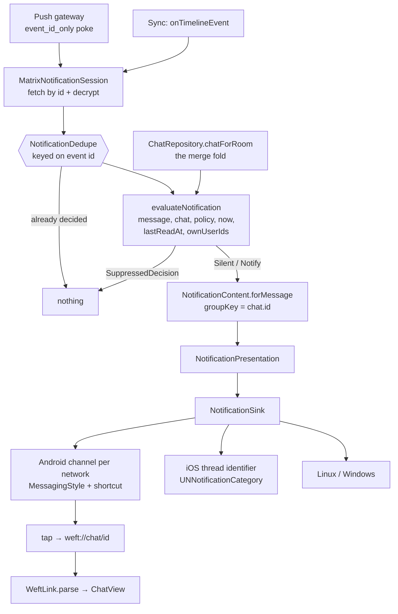
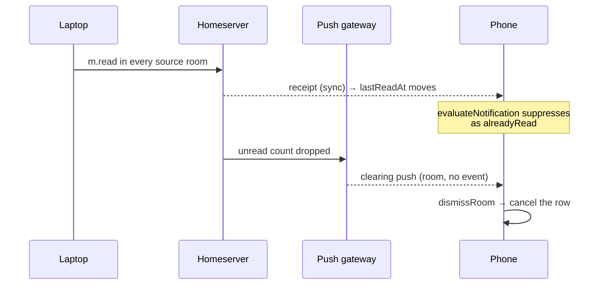

# Notifications

A messenger you have to open to discover you have messages is not a messenger.
This is how Weft gets from "the homeserver knows something happened" to a row in
the shade — and, more to the point, how it decides *not* to, which is most of
the work.

The shape is the same one [the attachment pipeline](attachment-pipeline.md)
takes. Everything that can be decided without a device is decided in a pure-Dart
package that runs under `dart test` in about a second: `weft_notify` answers
*should this notify, what should it say, and which conversation does it belong
to*. Below it, `weft_matrix` supplies the three things that package cannot know
— a decrypted event, a read receipt, and a homeserver — and above it the app
turns a decision into an Android channel, an iOS thread identifier, or a D-Bus
call. The interesting file has no plugin in it and the file with the plugin in
it has no decisions.

| Layer | Where | What it owns |
|---|---|---|
| Decide | `packages/weft_notify/lib/src/rules.dart` | `evaluateNotification`, `NotificationPolicy`, the dedupe ledger |
| Render | `packages/weft_notify/lib/src/content.dart` | `NotificationContent`, the group key, `summarise` |
| Feed | `packages/weft_matrix/lib/src/push_delivery.dart` | Sync and push both reaching the same `evaluateNotification` |
| Register | `packages/weft_matrix/lib/src/pusher.dart`, `push_rules.dart` | The pusher, and the server-side rules kept in step with it |
| Present | `apps/weft/lib/services/notifications/notification_presentation.dart` | `NotificationContent` → `NotificationDetails`, with no device involved |
| Post | `apps/weft/lib/services/notifications/notification_service.dart` | What is currently on screen, when a summary replaces it, where a tap goes |
| Act | `apps/weft/lib/services/notifications/notification_actions.dart` | Reply, mark read, mute for an hour, remind later |



## `event_id_only`, and why the body never leaves the device

`MatrixPusherRegistry` registers this device's pusher with `format:
event_id_only` (`kEventIdOnlyFormat`). Omit that one field and the homeserver
puts the event's `content` into the push it hands the gateway — so the plaintext
of every message in an unencrypted room crosses a push gateway, Google's FCM or
Apple's APNs, and the platform's own notification service, in that order.

The argument for sending it anyway is that the device then has something to
display without a round trip. It does not survive contact with Weft's actual
rooms: for an **encrypted** room the payload is ciphertext the gateway cannot
use and the app must fetch and decrypt regardless, so the body buys nothing; for
an **unencrypted** one it buys a fraction of a second at the cost of publishing
the message. There is no case where it is the better trade, which is why the
format is set unconditionally rather than being a setting.

Two consequences follow, and both are load-bearing elsewhere:

- **A poke is a question, not an answer.** `MatrixNotificationPipeline.handlePush`
  gets a room id, an event id and an unread count. It fetches the event through
  the live session, decrypts it locally, and only then has something to evaluate.
- **iOS needs a notification service extension**, because an `event_id_only`
  push has literally nothing to show. `kIosDefaultPayload` sets
  `mutable-content: 1` so the extension gets its chance, with a placeholder
  alert for the half-second before it runs and for the case where iOS kills it
  for going over budget. The extension lives at
  `apps/weft/ios/NotificationService/`. Phase 03 authored it and left it out of
  the Xcode project; **Phase 04 registered it**, alongside the Share Extension.
  `apps/weft/ios/NotificationService/README.md` records why that turned out to be
  an ordinary text edit after all. It still does not decrypt, and still needs a
  provisioning profile of its own before a device build will sign.

`append` defaults to false, which tells the homeserver to drop any other pusher
registered against the same device token — two pushers on one token is two
buzzes per message. `ensureRegistered` skips the write when the server already
agrees, and *rewrites* a pusher whose stored format is not `event_id_only`, so
upgrading past an older build stops the homeserver sending bodies without the
user doing anything.

**What the pusher cannot infer is which pusher was this device's.** Every device
of an account registers under the same app id with its own token, so "the other
pushers with my app id" is the user's other phones; deleting them to clean up
after a token rotation would silence push everywhere. The caller remembers the
previous push key (`SettingsPushKeyStore`) and passes it in.

Weft hosts no gateway. `notify.push_gateway` — a setting, with a
`--dart-define=WEFT_PUSH_GATEWAY` fallback — points at a
[sygnal](https://github.com/matrix-org/sygnal) the user runs, exactly as they
run their homeserver, and `PushRegistrationStatus.notConfigured` is a sentence in
the settings screen rather than a failure. Without it, and without a Firebase
config, Weft still notifies from sync while it is running; that path needs
nothing configured at all.

## The group key is the merged chat id, handed in

This is the decision the whole feature is built around, and the one most likely
to be quietly undone by a later change.

One person's WhatsApp and Signal legs are one conversation in Weft. If their
notifications group on the **room** id they are two threads in the shade: two
rows, two summaries, two "3 new messages" counts for one person, and a tap that
lands in half of a conversation. So `notificationGroupKey(Chat) => chat.id` —
`merged:<contactId>` for a contact with two or more legs, the plain room id
otherwise — and it is a named function with one call site precisely so there is
somewhere to grep when the merge shape changes.

The key is **handed in, never derived**. `MatrixChatRepository._applyMerges`
already performs the fold; `MatrixNotificationPipeline` takes a
`ChatForRoom` (`ChatRepository.chatForRoom`) and `evaluateNotification` takes a
`Chat`. A second answer to "which conversation is this room part of" is the
failure this design exists to prevent, and it would not be a crash — it would be
a merged contact that silently stops merging in the one place the user is
looking.

Two near misses worth naming:

- **Keying on `contactId`** merges every group chat into one thread, because
  `contactId` is null for anything that is not a DM.
- **Keying on `roomId`** is right for a single-source chat — the two ids are the
  same string — and wrong for exactly the case the feature exists for, which is
  why it survives casual testing.

What is *not* collapsed is the room. `NotificationContent` carries `eventId` and
`roomId` alongside the group key, because every action needs them: dismissing one
notification and the dedupe ledger key on the event, and a read marker lives in a
room. The group key cannot answer that — for a merged chat it names a
conversation no homeserver has heard of.

`threadId` is a getter returning `groupKey`. iOS and Android name the same
concept differently; Weft does not, and `notification_service_test` asserts the
two strings are equal because a merged contact whose iPhone stacks differently
from its Android is the exact failure this section is about.

Android's per-network **channels** are deliberately not grouping. A merged chat
posts to two channels, one per leg, so "mute WhatsApp, keep Signal" stays under
the control of the system's own settings screen, Do Not Disturb and a
smartwatch — while the group key still collapses both into one conversation.

## The read-receipt dismissal loop

A notification for a message the user has already read on their laptop is worse
than no notification. Weft closes that loop in both directions, and the same
receipt does both halves.

**Suppression, on the way in.** `evaluateNotification` takes `lastReadAt` and
suppresses anything not strictly newer than it. The value comes from
`room.receiptState.global.latestOwnReceipt?.timestamp` — the newest of the
user's public and private receipts — so reading on any device stops the others
buzzing as soon as that receipt syncs. The comparison is `!isAfter`, so a
message stamped exactly at the marker counts as read.

**Dismissal, on the way out.** Marking a chat read — from the chat view, or from
the notification's own "Mark read" action — writes `m.read` in *every* source
room of the chat. Two things follow from that one write:

1. The user's other devices now suppress the message under the rule above, so
   the notification stops being re-posted and any live client clears it.
2. The homeserver's unread count drops, so the gateway sends a **clearing
   push** — a payload with a room id and no event id. `MatrixPushPayload.isClearing`
   recognises it and `WeftNotificationService.dismissRoom` takes the row down.
   Treating one as a malformed message payload is how a notification outlives
   the message it was for.

`dismissRoom` resolves the room through `ChatForRoom` before dismissing, so
reading one leg clears the whole merged conversation — the user read the
conversation, not the room. When no chat claims the room it falls back to
whichever group keys hold a notification from it, which is correct for a
single-source chat and is the only thing that can clear a chat the inbox has
since dropped.



### Three surfaces, one verb, two mechanisms

The shade is not the only place a conversation is still saying it has something
unread. The watch companion and the home screen widget are showing the same
message, and a user who has read it expects all three to stop — a phone that
looks caught up while the wrist keeps buzzing is worse than one that clears
nothing.

`ConversationClearer` in
`apps/weft/lib/services/notifications/conversation_clearer.dart` is that one
verb, and it exists because the three do **not** clear the same way:

- **The shade** is cancelled by group key. It is the only one with rows that
  persist independently of the inbox.
- **The watch and the widget** read [the snapshot](companion-surfaces.md), which
  is derived from the chat list — so they clear by that list being *republished*
  with the count at zero. There is nothing to cancel; the only honest action is
  to publish the truth again, immediately, rather than waiting for whatever tick
  would have done it minutes later.

Both halves are attempted even when the first throws. Each failure is one
surface out of date, and letting it become two is what is worth avoiding.

The republish deliberately takes no argument. The list it should publish is
whatever the repository holds *now*, and a snapshot captured by a caller is one
taken before the read was recorded — which would put back the unread count the
clear was meant to remove. For the same reason `ChatView` sequences the clear
after `markRead` rather than beside it.

Every door into a conversation goes through it: the inbox tile, a notification
tap through the deep-link handler, a `weft://` deeplink, the two-pane
click-through, and — since threads — a thread opened from an indicator, which is
`ChatView` again with a root set and therefore covered by construction.

### Read on another device, while this one is awake

Reading on a laptop moves the account's `m.read`, the receipt syncs, and this
phone's unread count for that chat drops to zero **with nothing on the phone
having done anything**. The clearing push above covers a phone that is asleep.
`ReadElsewhereWatcher` covers one that is awake and holding a socket open, which
the gateway may skip entirely: it watches the chat list and clears any chat that
was unread on the previous tick and is not on this one.

The *transition* is what it acts on, not the state. A chat that has been read
for a week must not be cleared on every tick, because a new notification for it
can legitimately be posted between two ticks and would be wiped by the next one.
A chat that leaves the list entirely is deliberately not cleared either — it was
archived, deleted, or the account signed out, and `_stopInboxSurfaces` owns all
three.

It watches the chat list rather than raw receipts because a receipt is a *room*
fact and a notification is a *conversation* fact. Turning one into the other is
the merge fold, which the repository has already performed by the time a chat
reaches the watcher; a watcher over receipts would have to redo it, and would
get a merged contact wrong in exactly the way `dismissRoom`'s fallback describes.

## Server-side rules stop the push; the policy stops the display

Two places can silence a message and they are not interchangeable, so
`push_rules.dart` states the division once: **the homeserver's push rules
suppress the push, `NotificationPolicy` suppresses the display.** Only
suppression that is unconditional *and* durable is pushed down.

- A **mute a mention can break through** is never sent. With
  `mentionsBypassMute` on — the default — telling the homeserver not to push for
  a muted room means the mention that was supposed to get through arrives
  whenever the app next syncs. A bypassable mute is applied locally, where the
  body is readable.
- A **disabled network is** sent, because nothing bypasses it. That is what makes
  `disabledNetworks` and `mutedNetworks` two fields that behave differently
  rather than two names for one thing.
- **The global switch and quiet hours are never sent.** Push rules are *account*
  data and every client the user runs obeys them; writing quiet hours there would
  silence their laptop's Element at 23:00 because Weft is on their phone.
- **Unmuting is deliberately narrow.** Weft cannot tell a rule it wrote from one
  Element wrote — same rule id, the room id — so it only lifts a mute whose own
  record has lapsed: an expired *timed* mute, which is Weft-only because Matrix
  push rules have no expiry. Clearing someone's Element mute is the worse
  failure.

Rule order inside `evaluateNotification` is first-match-wins and the match is
reported as *the* reason: duplicate → own → redacted → state event → bridge
notice → globally disabled → reactions off → already read → network disabled →
network muted → chat muted → source muted → mentions-only → quiet hours. So a
muted chat during quiet hours reads as "That chat is muted" — the setting the
user would actually go and change, which is what the settings screen's test
button prints back at them.

`reactionsOff` covers the one kind of notice that is not a message. A reaction
to one of the user's own messages is mapped by `mapReactionNotice` into a
`WeftMessage` with `reactionKey` set and the reacted-to message's text as its
body, so the shade reads "Reacted 👍 to “See you at eight”". Whether it may
notify at all is `reactionsInDirectChats` or `reactionsInGroups` — on and off by
default — and after that it takes the same rules as any message, except that it
is never a mention: its body is the user's own words. Only reactions that reach
the app are seen: through sync, and through push for encrypted rooms. The
homeserver's default `.m.rule.reaction` keeps a plain-text room from pushing one.

`bridgeNotice` is the one rule in that list nobody chose. A mautrix bridge
narrates its own plumbing into its management room — "State update for
example.org: CONNECTED", and the `UNKNOWN_ERROR (mm-disconnected)` that preceded
it — as an `m.notice` sent by the bridge bot account itself, two per reconnect,
at whatever hour the remote network drops the socket. `mapEvent` flags those as
`WeftMessage.isBridgeNotice`; the message still lands in the timeline, because
that room is where a bridge which has been down since Tuesday is visible, but it
does not buzz. It is deliberately checked *before* the mention test: the body
repeats a server name on every line, and a user whose display name happened to
match would otherwise be paged through their own mute by a reconnect. The
sender, not the body, is what makes it chatter — a person relayed through the
bridge arrives from a ghost id and notifies normally, and so does anything the
bot sends as `m.text`.

## One event, two arrival paths, one decision

The same message routinely arrives twice: the poke wakes the phone and the sync
that follows carries the event. `NotificationDedupe` is a FIFO ledger of 512
event ids, checked **first** — before the fetch and before the decrypt, so a
phone woken to do them does neither. It is keyed on the event id alone, which is
globally unique, so one event seen through two legs of a merged chat is still one
decision; and the second delivery reads as `duplicate` whatever the first verdict
was.

The foreground path listens to `client.onTimelineEvent`, **not**
`client.onNotification`. The latter pre-filters by the server's push rules,
which would make the open app quieter than the woken one; the raw stream plus
`evaluateNotification` is what makes the two agree. The server's rules are not
lost — `Chat.muted` and `ChatSource.muted` are derived from `room.pushRuleState`,
so a server-muted room suppresses locally too.

## Coming back after a reboot

A messenger that stops delivering when the phone restarts, and does not start
again until somebody opens it, is a messenger people miss messages on for a day
without knowing. The two platforms solve it in ways that share no code and no
shape, so the honest thing is to describe them separately rather than to
pretend there is one mechanism.

### Android: a broadcast starts a service

`SyncBootReceiver` hears the boot broadcast and starts `WeftSyncService`, which
is the same foreground service the in-app toggle starts — so every rule about
foreground types and the daemon engine stays in one place, and a reboot goes
through the path that is already exercised.

Three things about it are easy to get wrong and each fails in silence:

- **Three actions, not one.** `BOOT_COMPLETED` is the documented broadcast and
  the only one most devices send. A number of vendor ROMs — HTC's originally,
  and the Chinese OEM forks that inherited its power management — send
  `android.intent.action.QUICKBOOT_POWERON` or
  `com.htc.intent.action.QUICKBOOT_POWERON` *instead*, after their "fast boot"
  shutdown, which on those phones is the ordinary way the device turns off. An
  app listening only for the documented one is never started on them, and it
  presents exactly as the bug was reported.
- **`specialUse`, not `dataSync`.** Android 15 forbids starting a `dataSync`
  foreground service from `BOOT_COMPLETED`; `specialUse` is not on that list.
  The type must be declared in the manifest *and* matched by
  `FOREGROUND_SERVICE_SPECIAL_USE`, or Android 14+ refuses the start. The
  service posts its notification inside `onStartCommand`, before the Dart engine
  starts, because the system allows roughly ten seconds and a cold device at
  boot is not fast.
- **A refused start is caught.** Android 12+ may refuse the foreground start
  outright. That costs one boot's connection and nothing else — opening the app
  restores it — and an uncaught exception in a boot receiver is a crash dialog
  on a phone somebody has just switched on.

**Between a reboot and the first unlock, an encrypted Android phone does not
sync, and that is deliberate.** The receiver is not `directBootAware` and does
not listen for `LOCKED_BOOT_COMPLETED`. Before the first unlock only
device-protected storage is readable, and everything the service needs — the
Matrix session, the account's own keys, the Olm store, and the preference saying
the connection is wanted at all — is credential-protected. A receiver woken
there would start a foreground service, post a notification on the lock screen,
fail to sign in, and stop: a visible failure in exchange for nothing. Moving
that data into device-protected storage to make direct boot work is the same
question answered worse — it would put an end-to-end encrypted messenger's
long-term keys somewhere the OS decrypts before anybody has proved they own the
phone. Push still wakes the app in that window if a gateway is configured,
because that path belongs to the system.

### iOS: there is no boot broadcast, and there does not need to be

iOS has no equivalent of `BOOT_COMPLETED`, no way for an app to arrange to be
launched at startup, and no long-lived background process. Asking for the
Android behaviour on iOS is asking for something the platform does not have.

What replaces it is that **a push wakes the app**, and nothing about a reboot
changes that. APNs holds the device's token across restarts, and a notification
delivered to a phone that has rebooted and not been opened since still launches
the app's notification service extension. Three pieces have to be in place, and
all three are:

| Piece | Where | Why it matters here |
| --- | --- | --- |
| `remote-notification` background mode | `ios/Runner/Info.plist`, `UIBackgroundModes` | Without it a data push never wakes the app at all |
| `mutable-content: 1` | `kIosDefaultPayload` in `push_registration.dart` | The only thing that gives the service extension a chance to run |
| The extension target | `ios/NotificationService/` | Where an `event_id_only` push becomes something to display |

The extension is registered and built and **does not yet decrypt** — see the
file's own comment and `docs/decisions/adr-002-ios-signing-handoff.md`. Until it
does, a push arriving after a reboot presents the placeholder alert from
`kIosDefaultPayload` and the real notification is posted when the app next runs.
That is a shape limitation, not a delivery one: the notification arrives, at the
right time, without the app having been opened.

### What the user must not do, on each platform

Different on the two platforms, and worth saying plainly because the advice is
opposite to what people expect:

- **Android — do not "force stop" Sennit**, and where the phone has an
  aggressive battery manager (Samsung, Xiaomi, OnePlus, Huawei), exempt Sennit
  from it. Force-stopping puts an app into a stopped state from which it
  receives *no broadcasts at all*, including `BOOT_COMPLETED`, until it is
  launched by hand. Swiping the app away from Recents is fine — `onTaskRemoved`
  hands the connection to the daemon and the service survives.
- **iOS — do not force-quit Sennit from the app switcher.** A force-quit on iOS
  stops the system delivering background pushes to that app until it is opened
  again. Locking the phone, switching apps and rebooting are all fine; the swipe
  up out of the app switcher is the one action that is not.

### Verifying it on a device

Nothing above is provable from a test runner: `sync_boot_test.dart` holds the
manifest and the receiver's handler to the same list of actions, and asserts the
direct-boot decision is still the one written down — but whether Android
delivers the broadcast, whether the foreground service is allowed to start at
boot, and whether the session survives are device facts. The steps:

```bash
# 1. Turn the built-in connection on in Settings, and confirm the service is up.
adb shell dumpsys activity services com.bostrot.weft | grep WeftSyncService

# 2. Reboot, and do NOT open the app afterwards.
adb reboot
adb wait-for-device

# 3. Unlock the phone — on an encrypted device BOOT_COMPLETED lands here — and
#    leave the app closed. The service should be running again.
adb shell dumpsys activity services com.bostrot.weft | grep WeftSyncService

# 4. Send a message from another account, still without opening the app.
#    The notification must arrive.
adb shell dumpsys notification --noredact | grep -A3 weft.messages

# 5. The negative case, which is the one that catches a receiver that never ran:
#    force-stop, reboot, and confirm nothing starts until the app is opened.
adb shell am force-stop com.bostrot.weft
adb reboot
```

Step 3 is the assertion. A service missing there and present after the app is
opened is a boot receiver that did not fire — check `adb logcat -s WeftSync` for
the refused-start warning, which distinguishes "Android said no" from "the
broadcast never arrived".

On iOS the equivalent is: reboot the device, do not open Sennit, and send a
message from another account. The notification should arrive; if the extension
has not been provisioned it arrives as the placeholder alert, which still proves
delivery. Force-quitting Sennit from the app switcher before the reboot is the
control case — the notification should then *not* arrive until the app is opened.

## Tap routing has one router and two front doors

A notification tap produces `weft://chat/${Uri.encodeComponent(chat.id)}`, which
is the same string a shared link produces, goes through the same
`WeftLink.parse`, and lands in the same `_handleLink` — so tapping a merged
contact's notification opens the merged conversation rather than one source room.
Building a second router was the temptation and would have been the bug.

Cold start is the platform's own replay:
`getNotificationAppLaunchDetails` holds the tap until Dart is listening, exactly
as `WeftIntents.deliverInitialIntent` does for a share. Android's conversation
shortcut — published from `MainActivity.publishChatShortcut`, and required before
Android will let a notification bubble or file itself under the shade's
conversation section — carries a plain `weft://chat/<id>` `ACTION_VIEW`, so a tap
from a bubble or from the launcher's long-press menu arrives through the
*existing* intent replay. One router, two front doors, both of them the
platform's.

What the replay lands on, though, is a chat screen in a process that is seconds
old, and the inbox it looks the conversation up in is still being folded
together — the room list comes back from the database, the merge pass runs over
it, and the rebuild is debounced to 1.5s while the first sync storm lands. So
`ChatView` does not take the first look as the verdict: an id the inbox has not
produced *yet* waits for it, drawing the same spinner an unsynced chat already
draws, and opens as soon as it turns up. The wait is bounded (`_chatArrivalGrace`)
and matches on the chat's room ids as well as its id, because the link carries
the id the chat had when the notification was posted and a merge since then has
moved it. Without that wait, every tap that cold-started Sennit landed on "That
conversation is not in your inbox" for a conversation that was about to be
there — the one failure a router cannot be blamed for, since it had already done
its job.

`WeftLink.parse` decodes exactly once. It used to decode twice —
`Uri.pathSegments` is already percent-decoded and the code called
`Uri.decodeComponent` on the result — which cancelled out for every id Weft
generates and threw `ArgumentError` for any id carrying a literal `%` or a
non-ASCII character, out of the one method whose contract is that an unknown
link must not crash the router.

## Actions run in the main isolate, on purpose

All three Android actions set `showsUserInterface: true`, so pressing one brings
Weft to the foreground. This is not a default left unexamined. Android routes an
action whose pending intent is a *broadcast* — which is what
`showsUserInterface: false` builds — to `ActionBroadcastReceiver`, which spins up
a **background isolate** and calls `onDidReceiveBackgroundNotificationResponse`;
the main isolate's handler never fires.

Every Weft action needs the Matrix client that lives in the main isolate: a reply
has to be encrypted with an Olm session, a read marker is a write through the
same `Client`, and a timed mute lands in the settings database the app holds
open. A second isolate would need its own vodozemac initialisation and its own
handle on that database. The reply text is still typed in the shade —
`RemoteInput` collects it before the intent fires — and what is lost is that mark
read and mute open the app. iOS keeps `foreground: false` and does them without
opening anything.

`cancelNotification` is false on all three: the plugin honours that flag only
inside the broadcast receiver these actions do not use, so the dismissal is
Weft's own and happens *after* the work succeeded. A reply that could not be sent
leaves its notification standing, which is the only remaining evidence that the
message was neither read nor answered.

**Background decrypt is not implemented, and that is a decision rather than an
omission.** A push arriving while the app is terminated wakes the process, and
the notification is posted when the isolate that owns the Matrix client next
runs. Advancing Olm ratchet state in a second isolate where the app cannot see it
can leave the app unable to decrypt the same event later.

## Presentation, in one file with no plugin in it

`NotificationPresentation.forMessage` turns a `NotificationContent` into an id, a
payload and a `NotificationDetails` with no plugin, no channel and no device
involved, which is why most of the app-level notification tests need none of
those either.

- **Ids are a function, not a counter.** `stableNotificationId` is FNV-1a folded
  into 31 bits — positive because Windows rejects a negative id, never zero
  because some launchers read 0 as "no id". The same event must produce the same
  id in the sync path, in the push path, and in a process that starts an hour
  later to dismiss it, which a counter cannot do.
- **The payload is JSON in a string**, because that is the only shape every
  backend carries: an Android intent extra, iOS `userInfo`, a Linux D-Bus hint.
  A *bare* `weft://…` link decodes to a link-only payload rather than to null,
  because that is what the iOS service extension — which renders from the push
  payload and cannot construct one — will post.
- **Previews off degrades the body only.** Title and sender survive, which is
  Android's "hide sensitive content" reading; a caller wanting iOS's stricter one
  degrades those two with `copyWith`. Because the summary is built *from*
  already-rendered contents, preview suppression flows into the inbox lines for
  free.
- **No emoji in the body.** A notification body is read aloud by TalkBack and
  VoiceOver; the inbox keeps the decorated version for the surface people look at
  rather than listen to.
- **The shade is bounded.** The newest five messages per chat keep a row of their
  own and older ones are *cancelled*, living on in the summary's count — so nine
  unread messages read "9 new messages" over five rows. 99 are remembered,
  because the count and the row are different questions.
- **Posting is serialised** through a future chain: `_post` awaits an avatar
  download and several plugin calls, and two messages decided in the same tick
  would otherwise append to one thread out of order and race to post two
  summaries that each believe they are the latest.

## Tests

**171 tests in `weft_notify`** (`rules_test` 88, `content_test` 59,
`dedupe_test` 18) with fixtures built by a small local helper — no Flutter, no
homeserver, about a second. **61 in `weft_matrix`** for the pusher, the push-rule
reconciliation and the two delivery paths. **78 in
`apps/weft/test/notification_service_test.dart`** and **25 in
`notifications_screen_test.dart`**, of which the presentation and action-handler
groups need no plugin at all; the `LocalNotificationSink` group stands a **fake
platform plugin** behind the real Dart half of `flutter_local_notifications`, so
what is asserted is the method call a device would receive — through the standard
codec in both directions, which is the only place a `Color` or a `Person` that
would not encode shows up before it crashes a phone.

What no test can establish is on the list below, and all of it was run on a
Pixel-class Android 16 emulator against the local Synapse:

| Checked on a device | Evidence |
|---|---|
| The APK builds and installs | `flutter build apk` after `isCoreLibraryDesugaringEnabled` was added — `flutter_local_notifications` requires it, and without it the whole Android build fails at `checkDebugAarMetadata` |
| Channels are created and used | `dumpsys notification` → `channel=weft.messages.matrix` |
| The conversation shortcut is accepted | `shortcut=chat__…_localhost found valid? true` — Android silently drops a `shortcutId` naming a shortcut that does not exist, so this is the only proof the notification can bubble |
| `MessagingStyle` renders | Sender avatar, conversation title and body in the shade's conversation section |
| The three actions appear | Reply / Mark read / Mute for 1 hour, `actions=3` |
| The test button posts | "Posted on the Matrix channel", one row, one shortcut |
| A tap opens the right chat | Warm, and again after `am kill` — the cold start replayed through `getNotificationAppLaunchDetails` and landed in the same conversation |
| Direct reply sends | Typed in the shade; the room read back over the API shows an `m.room.encrypted` event from the replying account, so it went through the real client in the main isolate |

The one thing on that list that cannot be reproduced is a *push*: it needs a
sygnal instance and a Firebase project, neither of which this repository can
host. On a device without them the settings screen says so in a sentence and
notifications arrive from sync, which is what the run above exercised.
