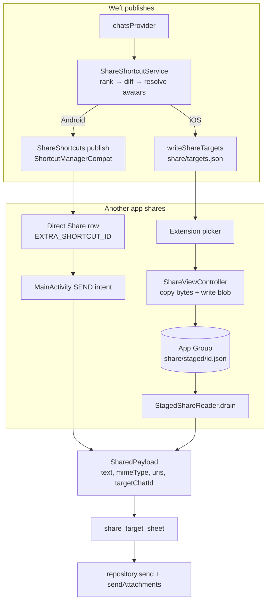
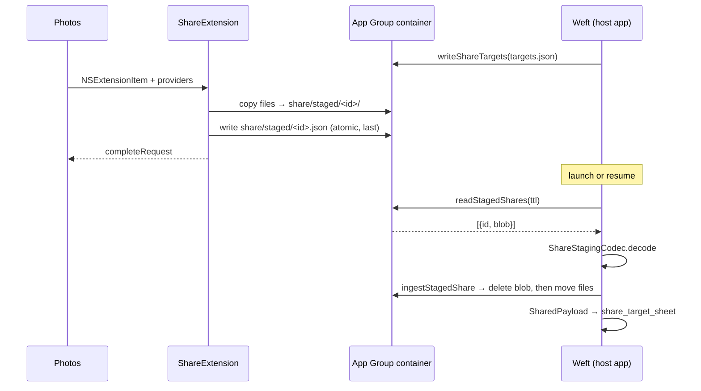

# Share Surfaces

Getting *into* Weft from another app is two entirely different mechanisms and
one product. Android publishes conversations to the launcher through the People
API, so a photo shared from the gallery offers Anna's face before it offers
Weft's icon. iOS runs a Share Extension — a separate process, a separate bundle
id, no Matrix session and a memory ceiling low enough that reaching for one
would kill it — which copies the bytes into a shared container and lets the host
app finish the job whenever it next runs.

Nothing about those two is alike as plumbing. Exactly two questions are the same
as *product*: **which conversations do we offer and in what order**, and **what
shape does a captured share take while it waits**. Both are decisions rather than
platform calls, so both live in `packages/weft_share` and are tested under
`dart test` with no device — the same split [the attachment pipeline](attachment-pipeline.md)
and [notifications](notifications.md) take, for the same reason.

| Layer | Where | What it owns |
|---|---|---|
| Rank | `packages/weft_share/lib/src/ranker.dart` | `ShareTargetRanker` — pinned tier, decayed recency, saturated frequency, a stable tie-break |
| Filter | `packages/weft_share/lib/src/capability.dart` | `NetworkShareCapabilities` — what each remote network will actually take |
| Publish shape | `packages/weft_share/lib/src/slot.dart` | `ShareTargetSlot`, `shareTargetSlotId`, the labels |
| Stage | `packages/weft_share/lib/src/staging.dart` | `StagedShare`, `ShareStagingCodec` — the App Group contract, total by construction |
| Drive | `apps/weft/lib/services/share/shortcut_service.dart` | The inbox subscription, the publish **diff**, avatar resolution, the logout clear |
| Drain | `apps/weft/lib/services/share/staged_share_reader.dart` | Reading the container on launch and resume, idempotently |
| Android | `android/…/ShareShortcuts.kt`, `res/xml/shortcuts.xml` | `ShortcutInfoCompat`, the share-target declaration, `EXTRA_SHORTCUT_ID` |
| iOS write | `ios/ShareExtension/ShareViewController.swift` | Copying items out of `NSItemProvider`, the picker, the blob |
| iOS read | `ios/Runner/ShareChannel.swift`, `ios/Shared/ShareContainer.swift` | `com.bostrot.weft/share`, the container layout, the orphan sweep |
| Choose | `apps/weft/lib/features/share/share_target_sheet.dart` | The sheet both platforms land in |



## One list, published two ways

`ShareShortcutService` is the whole Dart half of both surfaces, and
`ShareTargetPublisher` is a two-method interface with two implementations:
`WeftIntents` (Android, the `/intents` channel) and `WeftStagedShares` (iOS, a
file in the container). `shareTargetSurfaceProvider` picks between them on
`defaultTargetPlatform`.

Everything above that seam — the ranking, the diff, the avatar resolution, the
cap, the logout clear — is one implementation, which is the point of having it.
The alternative was an Android service and an iOS service that agreed by
inspection, and they would not have kept agreeing: the diff alone is four
interacting pieces of state.

The provider is *composed over* `shareTargetPublisherProvider` rather than
branching inside it, so `app/intents.dart` does not have to import a service that
imports it back. That one line is exercised in tests under
`debugDefaultTargetPlatformOverride`, because inverting it is silent on both
platforms: iOS would publish over a channel with no handler, Android would write
a file nothing reads.

## The shortcut diffing rule

**The publish that matters is the one that does not happen.**

`watchChats` emits on everything — a read receipt, a typing indicator, an unread
count moving, a presence change, a message in a conversation nowhere near the top
eight. The *published* set changes on a small fraction of those. Republishing on
the rest costs a launcher re-layout each time, which is visible as a share sheet
that stutters while it is open, and on some launchers as icons that blink out and
back.

So `ShareTargetSlot` equality covers **every field, `rank` included**, and
`_publishOnce` compares the freshly ranked list against `_published` and returns
without touching the platform when they match. An unread count moving is not a
republish. A reorder is. A rename is. The suite pins each of those by name.

Three things about that state are easy to get subtly wrong, and each is a
comment in the file because each was:

- **The diff is at the call, not inside it.** `ShareShortcuts.publish` takes the
  *complete* set, because it also removes whatever fell off it — a share sheet
  still offering a conversation archived last week is the failure it exists to
  prevent. There is no shape of "push slot 3 only" to hand it, so suppressing the
  call entirely is the only delta available, and it is the one worth having: the
  set is stable for minutes at a time and the stream is not.
- **`_published` holds what was *asked* for, not what the device took.** Android
  guarantees only five dynamic shortcuts per activity and the ranker defaults to
  eight, so a phone can publish a prefix and say so. Storing the prefix would make
  the next identical rank look like a change, forever — the exact thrash the diff
  exists to stop. A return of **zero** against a non-empty request is read the
  other way, as a refusal, and resets the state so the next tick retries.
- **Avatars resolve after the diff, never before.** Resolving eight faces on every
  read receipt is eight cache lookups and, the first time, eight authenticated
  downloads — for a publish that is then suppressed.

`publishOne` is deliberately *not* a one-element `publish`. The notification path
publishes a shortcut for whichever chat just got a message, which is frequently
not in the ranked set; routing it through `publish` would remove every other
shortcut and empty the share sheet on every notification. It pushes at
`rank = Int.MAX_VALUE` so it does not displace a pinned conversation until the
ranker's next pass.

Stale removal happens **before** pushing rather than after, so a full set can be
replaced by a different full set on a device whose cap equals the list length. It
uses `removeLongLivedShortcuts`, because plain dynamic removal leaves the
launcher's cached copy of a long-lived shortcut behind — which is the entire
point of long-lived, and the reason a signed-out phone needs an explicit clear.

## One shortcut id, three surfaces

`shareTargetSlotId(chat.id)` — `chat_` plus the chat id with everything outside
`[A-Za-z0-9_.-]` replaced — is the same string in three places: the launcher
shortcut, the iOS picker row, and the notification `MessagingStyle`'s
`shortcutId` from [[Notifications]]. `chatShortcutId` in
`notification_presentation.dart` is now one line delegating to it.

Two derivations of one id do not fail loudly. Android **silently drops** a
`shortcutId` naming a shortcut that does not exist, so the symptom is a
conversation that quietly stops bubbling, months later, in a build nobody
associates with the share work. The delegation is not the interesting part; the
consequence is, and that is what the suite asserts.

The sanitising is **lossy**, which is why `ShareTargetSlot` carries both `id` and
`chatId`: `!a:example.org` and `_a_example.org` both become
`chat__a_example.org`. Android hands back the sanitised id in
`Intent.EXTRA_SHORTCUT_ID` and nothing can invert it, so `ShareShortcuts` keeps a
shortcut-id → chat-id map in `SharedPreferences`. Preferences rather than memory
because the share that needs it is almost always a cold start. An id with no map
entry resolves to null and the sheet falls back to the picker — a launcher holds
a long-lived shortcut for weeks, and the chat behind one can have been archived
or unmerged since.

The iOS extension writes `ShareTargetSlot.chatId` directly and never the
sanitised id, because only Android keeps the map back.

### Two categories, and neither goes where the phase first said

A conversation shortcut needs `android.shortcut.conversation` to be treated as a
person, and a `<share-target>` in `res/xml/shortcuts.xml` whose categories
intersect the shortcut's before it appears in another app's sheet. Both
categories live on the **shortcut** and on the **share-target**, not on the
manifest's `SEND` intent filters: an intent-filter `<category>` is matched
against `Intent.addCategory`, and no sharing app on earth adds
`android.shortcut.conversation`. Putting it there would stop the filter matching
any share at all. The manifest gets the
`<meta-data android:name="android.app.shortcuts">` element and nothing else.

`shortcuts.xml` carries a `*/*` `<data>` row on purpose. A gallery sharing a
photo and a video together declares `*/*`, and without that row one of the most
common shares there is falls back to the plain app icon while every single-file
share shows faces. It is not wider than the intent filters, which still decide
whether Weft is offered at all.

## The ranker, and why capability is a filter

Four inputs, in the order they matter: **pinned**, **recency**, **frequency**,
**capability**. The first three produce an order; the fourth removes rows from
it and never reorders them.

- **Pinned is a tier, not a bonus.** A user who pinned a chat has already
  answered the question the ranker is asking, and no amount of accumulated
  recency elsewhere should overrule them.
- **Recency decays on a seven-day half-life** — long enough that a chat quiet
  over a weekend does not fall off, short enough that a conversation finished a
  month ago stops occupying a slot people are looking past. This is the signal
  that works on day one, which matters because a fresh install has nothing else.
- **Frequency is a thumb on the scale.** `sendCount` is decayed by the age of the
  last send and then saturated at `n / (n + 5)`, weighted 0.4 against recency's
  0.6. Six sends close a three-weeks-against-two gap; they do not rescue a chat
  silent for forty days. Sends are counted in memory for the run of the app and
  deliberately not persisted — a durable count needs a settings key, a bound, and
  an answer for what happens when a merged chat's id changes, and recency already
  carries the ranking from launch one.
- **The tie-break is load-bearing.** `List.sort` is not stable, and a fresh
  account scores *every* chat at exactly zero. Without `title` then `id` behind
  the score, the published set would change on every inbox tick for no reason a
  user could see — which is precisely the thrash the diff exists to prevent, sneaking
  in underneath it. `ranker_test.dart` asserts that reversed and rotated inputs
  produce byte-identical slot lists.

### Capability removes targets; it never scores them

`NetworkShareCapabilities` is a per-network table of attachment kinds and a
single maximum attachment size. Bluesky's chat takes images only, and small ones;
Instagram DMs take media and no documents; X takes pictures and video; SMS is
MMS, with a ceiling set by a carrier nobody can appeal to. A Signal-only chat is
not a target for a 100 MB video, because offering it produces a send failure the
user cannot act on.

The whole table resolves **toward allowing**, and the asymmetry is the reason:

> A cap set too low silently hides a conversation the user was looking for and
> gives them no way to find out why. A cap set too high offers a target whose
> send then fails with a sentence explaining itself. Hiding is the worse failure.

So unknown networks are permissive, `ChatNetwork.unknown` is permissive, any
network added to the enum without a row here is permissive, and every number is
set at the generous end of what the network documents. They drift, which is what
`overrides` is for — a value here being a year out of date should cost a settings
change rather than a release.

**Text-only shares skip the filter entirely.** Every network Weft surfaces
carries text; there is no such thing as a conversation that can be opened but not
written to.

### Where the filter is applied, and where it is not

The Android shortcut publisher ranks with **no `content`**, so no filtering. It
has to: the file a shortcut will eventually be handed is not knowable when the
shortcut is published, and a launcher holds it for weeks.

The share sheet has the files, so it filters — and it filters *into a second
section* rather than out of the list. A chat no leg of which can carry the share
is drawn below a "Cannot carry this share" header, disabled, with the reason on
the row, and search finds it. That is the same argument as above turned into a
widget: a conversation absent from a share sheet with no explanation is exactly
the failure the generous defaults were chosen to avoid.

Both surfaces read `shareTargetRankerProvider`, one provider over a `const`
object, so a tuned weight or a network override reaches both or neither. The
sheet ranks the *whole* inbox with a capability filter; the publisher ranks the
top eight without one; and the sheet reads `ShareShortcutService.activity` so
this run's send counts order its first rows the same way they ordered the faces
the user just tapped past.

### Three size caps, and none of them replaces the others

| Limit | Enforced by | Protects |
|---|---|---|
| `kMaxSharedFileBytes` (100 MiB) | `WeftIntents`, and again in the extension | the device — a share has to be *copied* out of its `content://` grant or `NSItemProvider` |
| `NetworkShareCapability.maxAttachmentBytes` | `weft_share` | the user's time — a leg that will refuse the file |
| the homeserver's `m.upload.size` | `planUpload`, in [[Attachment-Pipeline]] | the upload itself |

The first is about what Weft is willing to copy into its own cache and applies to
every share on every network. The second is about what one remote network will
take. They measure different things, and each is checked by the layer that knows
the number.

### The type has to be sniffed before it is judged

`ShareItem` holds a resolved mime type and a size — not an `AttachmentSource`,
because ranking happens twice with no bytes to hand. `ShareItem.fromSource` is
the bridge for when bytes do exist, and it goes through `sniffMimeType` rather
than the declared type for the reason [[Attachment-Pipeline]] gives at length: an
Android share intent routinely calls a 90 MB video `application/octet-stream`,
and an unsniffed one reaching `rank()` is judged against the *document* row and
offered networks that will refuse it. Pinned as its own test so the reason
survives.

## Why the iOS extension cannot hold a session

This is the constraint the whole iOS half is built around, and it is not a
matter of effort.

An app extension is a **separate process with a separate bundle id**. It does not
share the host app's address space, its keychain access group by default, its
open database handles, or its sync loop. To send a Matrix message it would need
to: open the store, initialise vodozemac, restore the device's Olm and Megolm
state, decrypt enough to know the room, encrypt an event, upload possibly 90 MB
of media, and advance ratchet state — while under a memory limit low enough that
`loadDataRepresentation` on a single large video is already fatal.

Two of those are worse than merely expensive:

- **Advancing ratchet state in a process the app cannot see** is how a device ends
  up unable to decrypt its own messages later. [[Notifications]] refuses
  background decrypt in the notification service extension for the same reason,
  and that extension does far less.
- **Linking the Flutter engine into an appex** is how an extension gets killed for
  memory before it has copied a photo. So `ShareViewController` imports UIKit and
  Foundation and nothing else, and the Podfile's `target 'ShareExtension'` block
  is deliberately **empty** — it exists only so CocoaPods generates
  `Pods-ShareExtension.*.xcconfig` for the target's own xcconfigs to `#include?`,
  which is what stops `pod install` warning about a base configuration it did not
  set.

What is left for it to do is exactly what it does: copy the bytes somewhere both
processes can read, write down what it copied, and complete the request. The send
happens in the app, later, through the same sheet an Android intent lands in.

`loadFileRepresentation`, never `loadDataRepresentation` — the former streams to a
temp file, the latter holds the whole thing. The URL it hands back is valid only
inside the closure, so the copy is synchronous there by necessity.

The **provider-loading order is load-bearing** and is pinned by a comment at the
branch: `public.file-url` before `public.url` before `public.plain-text` before
the file types. `file-url` conforms to `url`, and `plain-text` conforms to
`data`, so asking the general question first turns a shared file into its path as
text, or a selected sentence into a `.txt`.

## The App Group staging contract

One group, `group.com.bostrot.weft`, entitled to two bundle ids
(`com.bostrot.weft` and `com.bostrot.weft.ShareExtension`). The layout:

```
<group container>/
  share/
    targets.json          ← host app writes, extension reads
    staged/
      <id>.json           ← extension writes, host app reads and deletes
      <id>/               ← the copied files for <id>
        0-IMG_0001.HEIC
        1-IMG_0001.HEIC
```



Six rules hold it together.

**Paths are container-relative, always.** `containerURL(forSecurityApplicationGroupIdentifier:)`
returns a *different absolute path* in each process for the same group, so an
absolute path written by one is not a path the other can open.
`WeftShareContainer.relativePath(of:)` and `absoluteURL(forRelativePath:)` are
the only two conversions, and they resolve symlinks on both sides first —
the container is under `/var`, which is itself a symlink to `/private/var`, and
`NSItemProvider` hands back URLs spelled either way.

**`ios/Shared/ShareContainer.swift` is a member of both targets.** The group id,
the directory names and the relative-path rule are spelled once. Anything spelled
twice here is a pair that can drift into a share the writer can see and the
reader cannot, and there is no test that would catch it.

**The blob is written last, and atomically.** Files are copied first, so a kill
between the two steps leaves an orphaned `<id>/` directory with no blob —
invisible to the decoder, and therefore leaked bytes unless something sweeps it.
`sweepOrphanedFiles` does, TTL-gated by the same 24 hours Dart passes down.
The gate is not conservatism: an extension capturing a share *right now*, while
the app is being resumed in the background, is indistinguishable from one killed
between its two writes.

**`removeStagedShare` deletes the blob first.** A delete killed halfway then
leaves orphaned bytes rather than a share pointing at files that are gone, which
is the only shape the reader could mistake for valid.

**Both sides sanitise every filename.** The extension is handed a `suggestedName`
by whichever app is sharing; the host app is handed a `name` by a decoder
documented to pass through whatever it found. `../../Library/Preferences/…` is a
perfectly ordinary display name as far as either API is concerned, and both sides
then join it onto a directory URL. `absoluteURL(forRelativePath:)` refuses `..`
and leading `/` for the same reason.

**Files are named `<index>-<name>` in the container and renamed back on
ingestion.** A Photos multi-select routinely produces two `IMG_0001.HEIC`, and
the index also preserves the source app's ordering — but
`AttachmentSource.basename` becomes the Matrix event's `body`, and
`0-IMG_0001.HEIC` is not a filename anybody chose. The collision the prefix was
solving comes back at the destination and is answered there with `-1`, `-2`.

### The decoder never throws, and that is the contract

`ShareStagingCodec.decode` returns `null` for every malformed input rather than
raising. Not as a nicety:

> The writer is a process the system can kill at any instant, including between
> the first byte of the file and the last. The reader runs on the host app's
> **launch path**. A decoder that throws on a truncated blob turns a share the
> user has already forgotten about into an app that will not start — and will not
> start again, because the blob that killed it is still sitting in the container.

Refused, in every case without throwing: null/blank input; anything `jsonDecode`
cannot parse; a root that is not an object; a missing or empty `id` (the drain
cannot be idempotent without one); a missing or unparseable `capturedAt` (a share
that can never expire is worse than one lost); and a share with neither text nor a
usable file, which is what a blob written before its files were copied looks like.

Truncation was only half of it. `files` and `targets` are read through
`_listOrEmpty` rather than `as List?`, because a *wrong-typed* value —
`"files": "oops"` — raises a `TypeError`, which is not a `FormatException` and so
sailed straight past the `try` around `jsonDecode`. That was a real bug, found by
`staging_test.dart` and fixed before any Swift existed: the writer is hand-written
Swift with no compiler checking these key names, so a wrong type is exactly as
likely as a wrong length. The suite now decodes **every prefix** of a valid blob
and asserts each one is dropped, which is the property `ShareViewController` is
allowed to rely on.

The JSON key names are a cross-language contract with no compiler on either side
of it. Renaming one in `staging.dart` is a silent break in
`ShareViewController.swift`.

The blobs cross the channel **unparsed**, with the filename's id beside them.
`ShareStagingCodec` is the only decoder; a second hand-written parse in Swift
would be a second thing to keep in step. The id travels separately because a blob
that cannot be decoded still has to be *deleted*, and the id inside it is exactly
the unreadable part — without the filename's copy, one corrupt blob is re-read on
every launch forever.

### The drain does not send; it asks

"A share must not be sent twice" is really "must not be *asked* twice", and three
things answer it, in order of weight:

1. **The drain opens the sheet**, which needs a tap. The worst a duplicate can do
   is ask again.
2. **`ingestStagedShare` deletes the blob before it moves a byte**, so a second
   reader — a resume racing a launch, a process killed halfway — cannot find the
   share at all.
3. **`_handled` records the id before the first `await`**, so two overlapping
   drains inside one process cannot both reach the same share in the window
   between reading it and the platform deleting its blob.

Nothing is persisted, and nothing needs to be: the blob does not survive the
ingest. Every blob the drain reads takes exactly one of two exits — ingested, or
removed — and there is no third, which covers the ugly cases for free.

Ingestion is a **move**. Both containers are on the same volume, so `moveItem` is
a rename and a 90 MB video costs nothing to take ownership of; a copy is the
fallback, so a share degrades rather than vanishes.

**Two gates, not one, before a drain runs.** The session has to be ready *and*
`chatsProvider.value` has to be non-null. A drain in between would delete the
blob and hand the payload to a sheet that refuses to open — the share gone,
silently. `_drainPending` retries on the first chat list.

Expiry is 24 hours, judged on `capturedAt` in Dart because only the codec reads
it, while the platform side sweeps orphans with the same number passed down. Two
sweeps with two constants would eventually disagree about a share whose files are
gone and whose blob is not. A share drained three days later opens a compose
sheet for something nobody remembers choosing, on top of whatever they were
actually doing.

A blob over **256 KiB is not a blob**, and `readStagedShares` answers null for it
rather than reading it — this is the launch path. Sixteen shares per drain, which
cannot starve, because every share read is either ingested or removed.

## Landing in one sheet

Both platforms converge on `SharedPayload{text, mimeType, uris, targetChatId}`
and `share_target_sheet.dart`. `targetChatId` is the field Phase 04 added: an
Android Direct Share intent fills it from `EXTRA_SHORTCUT_ID` through the
preferences map, and the iOS extension fills it from its own picker.

The sheet is two steps — pick, then confirm — and a pre-selected target lands on
the **confirm** step rather than sending. That is deliberate on both platforms: a
Direct Share row is four small faces, a mis-tap is ordinary, and the confirm step
is the only place that shows *what* is going, lets the caption be edited, chooses
the network and adds a second target. "Choose another chat" is the escape, and it
clears a single selection while "Change selection" (the same button after a
multi-select forward) does not — because "another" means *replace* after one tap
and *add* after five ticks.

Per-target network selection defaults to the chat's stored send network **whenever
that network can carry the file**, and to the first capable leg otherwise:
honouring a stored Signal preference for a 150 MB video is honouring it into a
send that fails when the WhatsApp leg beside it reaches the same person. The
choice is never persisted — `setSendNetwork` is a standing preference for a
conversation the user is *in*, and a share is one gesture at a conversation they
may not have opened in weeks.

Previews reuse `_SharedFileStrip` → `AttachmentSourceThumbnail`, the same tile
the composer's pre-send sheet draws. `AttachmentBubble` was the instruction and
is the wrong widget here: it takes a `WeftMessage`, dispatches on `message.kind`,
and fetches pixels through `ChatRepository.attachmentBytes(roomId, eventId)`. A
staged share has no event, no room and nothing on the homeserver, so every photo
would draw the broken-attachment placeholder and reaching that placeholder would
mean fabricating an event id. The rule behind the instruction — no second preview
implementation — is satisfied by the strip, which *is* the first one.

## Three initials avatars, and why that is not a duplication bug

`WeftAvatar` (Flutter), `ShareShortcuts.initialsIcon` (Kotlin) and
`ShareTargetCell.initialsImage` (Swift) all draw a coloured circle with initials
in it. That is unavoidable rather than sloppy:

- Kotlin cannot call Flutter. Most launchers draw a target with **no** icon as the
  *app* icon, so eight conversations become eight identical Weft logos.
- The extension cannot resolve an `mxc://` URI at all — that needs an access token
  in a process that has no session. `iconPath` is dropped on its way into
  `targets.json` and would be useless if it were not: it points into the app's own
  container, which the extension is not entitled to read.

The Swift copy hashes with a hand-written djb2 because `String.hashValue` is
salted per process, so the colour would change on every launch.

The one place there *is* a shared cache is the real avatar: `avatarFileLoaderProvider`
is used by both the notification service and the shortcut service, same directory,
same headers, one download per face.

## What the device found that no test did

Both of these are worth reading as a caution about what a green suite proves.

**The launcher's captions read "Dr." and "Prof."** `shortShareLabel` cut at the
*first* word boundary, which is right for "Alexandra Kalinowska" → "Alexandra"
and useless for a title: "Dr." is not a name, and it is the *same* caption every
doctor in the inbox gets — a row of faces where two say the identical thing. It
now takes as many whole words as fit in the same twelve. A later short word
**stops** the label rather than being skipped onto the end: "Anna Kalinowska Jo"
is "Anna", not "Anna Jo", because a cut that is not a prefix of the title is not
a name at all.

**`main` had been failing CI's format check since the package landed.**
`dart analyze` and `dart format --set-exit-if-changed` are different gates and
only one of them was being run, task after task, each reporting clean. Run both.

## Tests

**93 in `weft_share`** — `ranker_test` 48, `staging_test` 45, over a
`test/support/fixtures.dart` with a pinned `now` so no assertion depends on when
the suite runs. **81 across the three app-level files** —
`shortcut_service_test.dart` (the diff, the cap, the logout clear, avatar
fallback), `staged_share_reader_test.dart` (decode-into-send, idempotency across a
double drain and across a drain that starts mid-ingest, expiry, every prefix of a
valid blob), `share_target_sheet_test.dart` (ranked rendering, pre-selection,
multi-select, per-target network). No Flutter in the first, no device in any.

Ordering assertions run inside `withClock(Clock.fixed(shareNow))`. Recency decays
on a seven-day half-life, so a suite run months after its fixtures were written
scores every chat at effectively zero and leaves the order to the tie-break:
green today, and green for the wrong reason afterwards.

The last ten cases came from `flutter test --coverage`, not from reading. The
twelve behaviours the phase named were all genuinely covered, so a reading pass
would have stopped there; line coverage answered the different question — which
*documented* behaviour has no test — and turned up the partly-failed forward's
snackbar, the oversize-file rejection banner, every two-file share, and the
platform branch above.

### Verified on a device

Android, on an API 36 emulator, in demo mode (`--dart-define=WEFT_DEMO=true`
yields a ready session and a `DemoChatRepository`, so the publish path runs for
real with no account):

| Checked | Evidence |
|---|---|
| Eight conversations published, correctly | `cmd shortcut get-shortcuts` — both categories, `rank` 0–7, a `bitmapPath` per shortcut |
| Faces appear in another app's sheet | A file shared from Files raises the system sheet with "Anna Maven", "Konrad Majewski", "Design Team" above the generic app row |
| A tap is a real Direct Share | `ShareResultSender: … directShare=true` in logcat, and a cold start landing on the confirm step for that conversation |
| The intent path directly | `am start -a android.intent.action.SEND --es android.intent.extra.shortcut.ID chat_merged_anna` |

The README's "Verifying Direct Share on a device" block carries the commands and
the two things that cost time: `adb shell` re-splits its argument, so an unquoted
`--es … "Hello from adb"` silently drops **every later extra** including the
shortcut id; and the sheet's icons load a second after its captions, so an
immediate screenshot is indistinguishable from the icon failure `initialsIcon`
exists to prevent.

**iOS has not run on a device, and cannot from this repository.** See
[ADR-002](../decisions/adr-002-ios-signing-handoff.md) for exactly what is
missing. What *has* been established is that both extension targets are
registered in `Runner.xcodeproj` and compile clean:

```sh
xcodebuild -project Runner.xcodeproj -target ShareExtension \
  -configuration Release -sdk iphoneos CODE_SIGNING_ALLOWED=NO
# ** BUILD SUCCEEDED **, no source warnings
```

## Not yet handled

- **The extension's picker shows initials, never faces.** Resolving an `mxc://`
  URI needs a token the process does not have. The host app could pre-resolve
  avatars into the App Group container beside `targets.json`; nothing does yet.
- **Send activity is per-run.** Frequency ranking resets on every launch. Recency
  carries it, which is why this has not been urgent.
- **`StagedShare.extras` equality is one level deep.** `MapEquality` compares
  values with `==`, so a share whose extras hold a nested object does not
  round-trip to an equal instance. The values pass through intact; whole-object
  equality is only promised for scalar extras, which is why the drain keys on
  `StagedShare.id` and never on comparing two decoded shares.
- **No iOS device verification of any of it**, per ADR-002.
