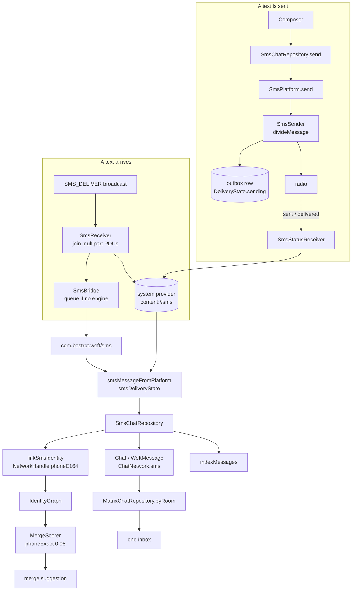
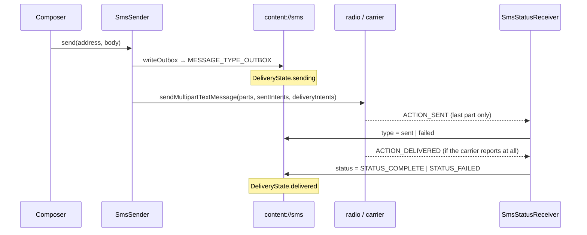

# SMS Integration

SMS is the one network in Weft's inbox that needs no bridge, no homeserver and
no account — and the one that makes the merge engine's argument on day one. A
new user signs in, grants the default-SMS role, and the WhatsApp chat with Anna
and the text thread with Anna are offered as the same conversation, because they
are the same phone number. No other network makes that visible before the second
bridge is configured.

It is also the network that tells the user the least. There are no read
receipts, no reactions, no edits, no redactions, and no encryption of any kind.
Everything below is shaped by those two facts: fold SMS into the same inbox as
everything else, and never let the fold imply that SMS is as safe as what it
sits beside.

The split is the one [the attachment pipeline](attachment-pipeline.md) and
[share surfaces](share-surfaces.md) take. Every decision — what a provider row
means, what a number normalises to, what a body costs to send, whether an SMS
address is the same person as a WhatsApp handle — lives in
`packages/weft_sms`, in pure Dart, and runs under `dart test` in about a second
with no SIM. Below it, Kotlin moves rows in and out of the system provider and
decides nothing.

| Layer | Where | What it owns |
|---|---|---|
| Identify | `packages/weft_sms/lib/src/phone.dart` | `PhoneNumber`, `PhoneNumberParser` — E.164, short codes, "do not guess" |
| Link | `packages/weft_sms/lib/src/identity.dart` | `linkSmsIdentity` — the `NetworkHandle` the merge engine already consumes |
| Count | `packages/weft_sms/lib/src/segment.dart` | `segmentMessage`, `SmsEncoding`, the GSM 03.38 tables |
| Map | `packages/weft_sms/lib/src/thread.dart` | `SmsThread`/`SmsMessage` → `Chat`/`WeftMessage`, the synthetic ids, `smsDeliveryState` |
| Plan | `packages/weft_sms/lib/src/mms.dart` | `planMmsPart` — what MMS will carry, and the sentence for what it will not |
| Read/write | `android/…/sms/SmsProvider.kt` | `content://sms`, `content://mms`, `content://mms-sms/conversations` |
| Receive | `android/…/sms/SmsReceiver.kt`, `MmsReceiver.kt` | `SMS_DELIVER`, `WAP_PUSH_DELIVER` |
| Send | `android/…/sms/SmsSender.kt`, `SmsStatusReceiver` | `sendMultipartTextMessage`, the two PendingIntents |
| Reach Dart | `android/…/sms/SmsBridge.kt` | `com.bostrot.weft/sms`, and the queue for events that precede the engine |
| Decode | `apps/weft/lib/services/sms/sms_platform.dart` | `SmsGateway`, `SmsPlatform`, `smsMessageFromPlatform` |
| Compose in | `apps/weft/lib/data/sms_chat_repository.dart` | Threads as `Chat`s, `SmsTimelineSource`, handles, the index feed |
| Say the cost | `apps/weft/lib/features/chat/sms_composer_bar.dart` | "Not encrypted", and the segment count |
| Ask | `apps/weft/lib/features/settings/sms_screen.dart` | The one place `ROLE_SMS` is requested, and the decline |



## The role is an obligation, not a permission

Being the default SMS app is not "SMS access with extra steps". It is a job
handed to exactly one app on the device, and the job is **owning the system
message store**.

`SMS_DELIVER` — the broadcast Weft's receiver listens for — goes to the default
app and to nobody else, and nothing in the platform writes the message down on
that app's behalf. `SMS_RECEIVED`, the action every tutorial shows, is the
read-only copy every other app can watch; it carries no obligation and is not
what the role is about. So `SmsReceiver` writes first and notifies second:

> A default SMS app that keeps its messages in a private database does not lose
> them from *Weft*. It loses them from the *phone* — from every backup tool,
> every other app that reads `content://sms`, and from whatever the user
> switches to next. The loss is invisible until the day they switch, which is
> the worst possible day to discover it.

That is why `SmsProvider.kt` is a `ContentResolver` wrapper and Weft has no SMS
tables of its own, and why the send path writes an **outbox** row before the
radio is called rather than a sent row after it.

### Eligibility is all-or-nothing and fails silently

Android decides whether Weft may even *appear* in the "Default SMS app" picker
by looking for a fixed set in the merged manifest:

| Required | Declared as |
|---|---|
| `SMS_DELIVER` receiver | `.sms.SmsReceiver`, `android:permission="android.permission.BROADCAST_SMS"` |
| `WAP_PUSH_DELIVER` receiver | `.sms.MmsReceiver`, `BROADCAST_WAP_PUSH`, `application/vnd.wap.mms-message` |
| `ACTION_RESPOND_VIA_MESSAGE` service | `.sms.HeadlessSmsSendService`, `SEND_RESPOND_VIA_MESSAGE` |
| `ACTION_SENDTO` activity filter | `sms:`, `smsto:`, `mms:`, `mmsto:` on `MainActivity` |
| Permissions | `READ_SMS`, `SEND_SMS`, `RECEIVE_SMS`, `RECEIVE_MMS` |

Miss one and the app is not offered the role. There is no exception, no log
line and no failed call — the entry is simply absent from a system list, which
is indistinguishable from having built the feature wrong. Hence the manifest
comment above each block and the device check in the [Verified on a device](#verified-on-a-device)
section below: seeing Weft in the picker *is* the manifest test.

The `android:permission` attributes are the other half. `SMS_DELIVER` is
accepted only from a sender holding `BROADCAST_SMS` — the system — which is
what stops any installed app from forging an inbound message into the store
Weft is about to write.

Two of the four entries are load-bearing beyond their own feature.
`HeadlessSmsSendService` is the dialer's "respond via message" button: it runs
while a call is ringing, usually over a locked screen and usually with Weft not
running, so it sends **in Kotlin** through the same `SmsSender` and never starts
a Flutter engine. Booting one to send eight words would take longer than the
call rings. `MmsReceiver` exists mostly for eligibility — see
[Incoming MMS are not retrieved](#incoming-mms-are-not-retrieved-and-say-so).

### The decline path is the design

Weft is a Matrix client that can also carry SMS, not an SMS app that also does
Matrix. Every "no" answer therefore has to produce an app that behaves exactly
as it did before, with the SMS network simply absent.

`SmsAvailability` is three states rather than a boolean because the two nos
lead to different screens:

- `unsupported` — no radio, or no channel handler at all. Every platform but
  Android, plus tablets and emulators without a modem. Nothing to offer.
- `notDefault` — the device can do SMS and another app is doing it. **A
  normal, fully supported state**, one tap from changing, and the state a user
  who declined the dialog is deliberately left in.
- `ready` — Weft holds the role.

`SmsPlatformStatus.hasPermissions` is reported separately from the role because
holding the role and holding the SMS permission group are not the same instant:
a role handed to another app in Settings while Weft is backgrounded revokes the
permissions underneath a read that is already running. A `ready` status with
`hasPermissions: false` is the state where every read comes back empty, and it
is worth being able to say so instead of showing an inbox that has quietly lost
a network.

Every call in `SmsPlatform` answers rather than throws.
`MissingPluginException` is the ordinary condition of four of Weft's five
platforms and reads as "no SMS here"; a `PlatformException` is a role that
changed under a call, which is a thing users do while an app is open. Neither
may take down an inbox whose other networks are working.

`sms_screen.dart` is the only place `requestRole()` is called, and it is its own
screen rather than a row on the bridges screen because of the distinction that
screen already draws: bridges are servers the user runs, and this is a
permission the *phone* grants. Nothing on it is configured. Its copy is written
for the state after a decline, not before it — the role is offered once, in
plain terms about what it costs, and a refusal is reported in a quiet box rather
than a SnackBar that slides away, so the user can look at the screen afterwards
and see the state they chose rather than a failure.

The inbox's menu entry is gated on `!kDemoMode && defaultTargetPlatform ==
android`, **stated rather than read from the provider**. Watching
`smsRepositoryProvider` from the inbox shell would construct a real
`MethodChannel` and read `storesProvider` for a menu that may never open — and
`storesProvider` throws before bootstrap, which is exactly the state the inbox
golden pumps in.

## A phone number is merge evidence, and a wrong one merges strangers

This is where SMS earns its place in the merged inbox, and it is one function:

```dart
NetworkHandle? linkSmsIdentity(String address, {PhoneNumberParser parser, ...})
```

**There is no new evidence type, and that is the point.** `weft_merge` already
reasons in `NetworkHandle`s: `MergeScorer.score` normalises `phoneE164 ??
remoteId` on both sides and raises `MergeSignal.phoneExact`, which alone scores
0.95 against a 0.55 suggestion threshold. An SMS thread from `+441234567890` and
a WhatsApp handle for the same number become a suggestion in the existing merge
screen, with the existing "Same phone number" explanation, without a line of
merge code changing. That claim is asserted end to end in
`sms_repository_test.dart` against an untuned `MergeScorer()`, not argued for
here.

`phoneE164` is set explicitly even though the scorer would recover it from
`remoteId` anyway, because the merge UI *shows* the field, and evidence the user
can read is evidence they will act on.

Four rules keep this from merging the wrong people.

**One normaliser, not two.** `PhoneNumberParser` wraps `weft_merge`'s
`normalizePhone` rather than reimplementing it, which is why `weft_merge` is a
dependency of `weft_sms` despite the two having nothing else in common. The
scorer runs that same function on the *bridged* side of every comparison; a
second normaliser would drift and silently stop matching, and nothing would
fail — threads would just stop being offered as merges.

Writing this surfaced a real bug in `normalizePhone`, now fixed with a
regression test. An 11-digit national number with no `defaultCountryCode` fell
through every branch and returned `+01234567890` — not E.164, since no country
calling code begins with `0`, and worse, it *compares*: the same national digits
dialled in two countries folded to one string and merged two strangers.

**No region means no guess.** `PhoneNumberParser.defaultCountryCode` is
constructor state, read from `WeftSettings.defaultCountryCode`, and is **unset
by default and deliberately not inferred from the locale**. The asymmetry is the
whole argument:

> A missing country code fails to merge two chats that are the same person,
> which the user can fix in one tap on the merge screen. A wrong country code
> merges two chats that are different people, and mixes two strangers'
> conversations with nothing on screen to suggest it happened.

With no region set, only international-format numbers become evidence.
A settings control for the key is not yet built.

**Short codes are checked before normalisation, not after.** With a region set,
`normalizePhone` would happily read `20202` as a national number and prefix it
into a plausible E.164 — turning every bank alert into a "person" who can be
merged with somebody. `PhoneNumber.isShortCode` is derived from the leading `+`
rather than stored (a second field saying the same thing can disagree with the
string it describes), and `linkSmsIdentity` returns null for them. Also null:
alphanumeric sender ids like `Vodafone`, which have no number at all, and any
national-format number with no region to anchor it.

**Group threads contribute no handles.** `SmsChatRepository.handles` skips
`isGroup` threads, for the same reason `MatrixChatRepository` builds handles only
from direct chats: a group member's handle carrying the group's room id would
fold that whole thread into somebody's DM the moment the two were merged.

Nothing here auto-merges. `MergeScoringConfig.autoMergeOnIdentitySignal` stays
at its `false` default, because SMS is the one network where a number is
recycled by the carrier, spoofed by a sender, or shared by a household.

### The synthetic ids

SMS has no rooms and no events, and every layer above `weft_domain` addresses a
conversation by a room id — the merged timeline, the notification ledger and the
search index all key on one. `thread.dart` mints them:

| Function | Shape | Why |
|---|---|---|
| `smsRoomId(threadId)` | `sms:thread:42` | Lets an SMS thread travel the same path as a bridged chat |
| `smsEventId(messageId)` | `sms:msg:1337` | Addressable for a delivery report |
| `smsHandleId(number)` | `sms:+441234567890` | Keyed on the number, so re-reading upserts one handle instead of growing one per sync |
| `smsGhostUserId(number)` | `@sms_+441234567890:local` | Shaped like a bridge ghost, so `normalizePhone` reads the number back out |

The `sms:` scheme is deliberately **not** Matrix-shaped: a real room id starts
`!` and a real event id `$`, so anything that mixes the namespaces up is visible
on sight rather than after a failed federation call. `isSmsRoomId` is a
predicate on the string rather than a lookup in the thread map, because the
question is asked exactly when the answer is not yet known — routing a send
before the provider has been read, or opening a deep link into a thread that has
not synced. A lookup would answer "no" for those and send an SMS to a
homeserver.

The ghost-id round trip is pinned by a test:
`PhoneNumberParser().parse('@sms_+441234567890:local')` returns
`+441234567890` with no region set, so the id degrades to the right answer
wherever it is treated like any other handle's.

## Segment counting is not a division

GSM-7 gives 160 characters; one curly quote pasted from a word processor drops
that to 70 for the whole message; nothing on the keyboard says so. That is the
single most common way a message the user thought was free becomes three
billable ones, and `segmentMessage` exists to say it before the send.

Three things make it more than arithmetic.

**The GSM-7 table is narrower than it looks.** `à` is in the default alphabet
and `á` is not; `Ç` is and `ç` is not. Any composer indicator that guesses from
"looks like Latin text" is wrong for exactly the characters that cost money, so
`SmsEncoding` comes from `segmentMessage` and never from an ASCII check at the
call site. The table is written positionally in `segment.dart` so it can be
checked against the spec by eye.

**Ten characters cost two septets each.** The GSM 03.38 extension table —
`^ { } \ [ ] ~ |`, form feed, and the euro sign — is sent as ESC plus the
character. A hundred left braces is two hundred septets and two segments, and €
is the one users hit constantly with no idea it is double-width.

**A two-unit character is never split across a segment boundary.** An escape
sequence whose ESC lands in segment one and whose character lands in segment two
renders as garbage on the receiving handset, so a real encoder leaves the odd
septet unused and starts the pair in the next segment. `segmentMessage` packs
greedily with that rule, which is why the count is not `ceil(units / capacity)`:

| Body | Units | Naive division | Actual |
|---|---|---|---|
| 152 × `a` + 77 × `{` | 306 septets | 2 segments | **3** |
| 67 emoji | 134 UTF-16 units | 2 segments | **3** |

Both are asserted against the naive division in `segment_test.dart`, so the
composer's warning cannot silently regress to arithmetic.

The concatenated capacity (153 septets, 67 code units) is lower than the single
one (160, 70) because a concatenated segment spends six octets of its payload on
the UDH saying which part of which message it is. This is why a 161-character
message is two segments of 153 rather than 160 + 1 — and why the composer says
"2 messages" at 161 characters, which `sms_composer_test.dart` pins.

`SmsSender` always uses `divideMessage` + `sendMultipartTextMessage`, never
`sendTextMessage`. A body over one segment sent as a single message is silently
truncated by some stacks and rejected by others, and `divideMessage` splits on
the same septet boundaries `segmentMessage` counted — so the warning and the
wire agree.

## The composer says it is not encrypted

`SmsComposerBar` is a two-item strip above the text field, and it appears only
when the selected send network is SMS. A bridged chat gets no bar at all.

The left item is the important one. Every other network in Weft's inbox arrives
over an E2EE Matrix room; SMS is plaintext across the air interface and sits
readable in the carrier's logs, and Weft cannot change that. A composer that
looked identical to the encrypted one would be the app telling a lie by
omission. So the bar reads **"Not encrypted"** with an open-padlock glyph in the
network's colour, and it says so before a single character is typed — the state
is a property of the network, not of the message.

The right item is the cost, driven by `segmentMessage` and live from the first
keystroke through a `ValueListenableBuilder` over the composer's controller. It
counts *down* — `147 left` — because the number that matters to someone typing
is how close they are to the next charge, not how many units they have spent. It
turns the network's colour only once the message has actually become multipart;
colouring it from the first character would make the warning invisible by being
constant. The encoding is named only when it is the *reason* for the count:
`2 messages · UCS-2` tells someone who pasted a curly quote what to look for,
where a single GSM-7 segment needs no explanation.

This is also why `smsDeliveryState` can never return `DeliveryState.read`. SMS
has no read receipts; a thread being read is local state that never travels, and
nothing may claim the other person saw the message. An **inbox** row returns
`null` rather than `sent`, because ticks belong to messages the user sent and
painting them on a received bubble is wrong in a way that looks deliberate.

The one colour change this track made was for the same reason: `ChatNetwork.sms`
and `ChatNetwork.unknown` were both `0xFF7C8794`, so a chat whose network failed
to resolve and a genuine SMS chat drew the same swatch — precisely the
distinction a merged conversation's per-message glyphs exist to make. `sms` is
now `0xFFB0742A`.

## One inbox, not a tab

`SmsChatRepository` is **not** a `ChatRepository` and must not become one. SMS
answers a strict subset of that interface — no reactions, no edits, no
redactions, no read receipts — so implementing it would mean a dozen throwing
methods. It is instead composed into `MatrixChatRepository`, which:

- puts SMS chats into the **same** `byRoom` map the Matrix rooms go into, which
  is what makes an SMS thread eligible for `_applyMerges` and therefore for the
  watermark rules in [[Merged-Timeline]];
- upserts SMS handles into the same identity graph;
- routes `send`, `markRead`, `_openTimeline` and `closeTimeline` by
  `ChatSource.network`. `_sendRoom` was split into `_sendSource` + `_roomFor`
  for exactly this: the chosen leg is no longer always a room;
- hands its own `indexMessages` to `SmsChatRepository.indexer`, so SMS bodies
  land in the one hybrid index every other network's text lands in rather than
  a second one a query would have to remember to ask.

`SmsTimelineSource` is a `TimelineSource` like any other, so an SMS leg
interleaves with a WhatsApp one under the watermark rule instead of needing a
second timeline implementation. Its pagination is unusual only because the
system provider has no cursor API worth the name: a query takes a `LIMIT` and
returns the newest N rows. "Load older" is therefore a re-read with a doubled
limit, served from memory in between. A read that comes back exactly full is the
signal the provider is holding more; a deeper read that returns no more rows
pins the limit above what came back, which clears `hasMore` for good.

**Two things the inbox shows are not messages.** A thread nobody has opened
previews from the provider's `snippet` column under a `sms:snippet:<id>` event
id — deliberately *not* `smsEventId`, so a delivery report can never land on one
— and it is never `isOwn`, because the column says what the last message was and
not who wrote it. The real message replaces it on open.

### Sending is three events, not one call

`SmsManager.sendTextMessage` returns `void`. Conflating its stages is how an SMS
app comes to show a tick for a message that never left the building:



Only the **last** segment's PendingIntent reports, so a three-segment message
yields one outcome; a status receiver that moved the row to "sent" on part one
would be overwriting its own later failure. `STATUS_NONE` is `-1` and
`STATUS_COMPLETE` is `0`, so a status column defaulted to zero is a delivery
tick nobody earned — there is a test for exactly that.

On the Dart side, `incoming` and `statusUpdates` are two streams on purpose: one
appends a bubble and the other changes one already drawn, and merging them
duplicates every message the user sends.

### Refusals and silent no-ops

Three gaps are `StateError`s the composer already renders as a sentence, because
a message that could not leave has to reach the person who wrote it:
`sendAttachment` to an SMS leg (no PDU encoder), `send` to a group MMS thread
(one address only — picking the first would look like a group reply and be a
private message), and `send` where the platform returned no stored row.

Not refusals: `setArchived`, `setMuted` and `deleteChat` on an SMS chat are
**silent no-ops**, because `_roomsOf` filters SMS ids out when `getRoomById`
returns null. Closing that needs provider writes nobody has scheduled.

### The bridge is a singleton, and the queue is latency not durability

An SMS can *start the process*: the receiver runs with no activity and possibly
no Flutter engine, so `SmsBridge` is an object rather than a field on
`MainActivity`, and events that arrive before Dart attaches are queued — tagged
with their method, capped at 100 — and replayed by `getPending` /
`SmsPlatform.drainPending`. `SmsChatRepository.start()` subscribes **before**
draining, since a listener attached afterwards would miss exactly the messages
the queue exists to save.

Losing the queue loses nothing permanent: every message is written to the
provider first, so a process that dies before Dart attaches is a message
re-read rather than one lost.

`refreshStatus()` exists to avoid subscribing twice. `start()` is the only path
that attaches to the three streams, so the SMS screen's "Check again" takes it
only when nothing is subscribed yet — precisely the post-decline state — and
otherwise just re-reads the status field. Calling `start()` unconditionally
would leak a subscription per tap and duplicate every incoming message.

## MMS: what is planned, and what is not

Outbound attachments are planned by `planMmsPart`, which follows the same
sniff-first rule [[Attachment-Pipeline]] argues at length — a carrier transcodes
on the *announced* `Content-Type`, so announcing a JPEG that is really a HEIC
produces a part every receiver renders as a broken image.

The budget is **300 KB** (`kMmsDefaultMaxBytes`, Android's own `MmsConfig`
default) minus 2 KB of `kMmsOverheadBytes` for headers and the SMIL part, and
the choice of the conservative figure rather than the largest a carrier might
allow is the same asymmetry as everywhere else here:

> Under-sending costs a little image quality. Over-sending is rejected by the
> MMSC **silently** — the message sits in the outbox with no error the handset
> ever sees, and the sender finds out when the reply never comes.

`kMmsSupportedMimeTypes` is not a guess at what a modern phone can decode; it is
the intersection that survives an MMSC transcoder and lands on a ten-year-old
handset. Anything outside it is turned away here, with a sentence that names SMS
as the constraint and points at the other legs of the conversation — the reader
is about to wonder why the same photo sent fine an hour ago.

`MmsDecision` is sealed for the reason `UploadDecision` is: a caller that
forgets the rejection branch should fail to compile rather than hand the
platform a part the carrier will drop.

### Incoming MMS are not retrieved, and say so

This is the one obligation of the role that Weft does not meet, and it is
visible rather than quiet.

A `WAP_PUSH_DELIVER` does not carry the message. It carries an
`M-Notification.ind` PDU saying *that* an MMS is waiting and where to fetch it.
Retrieval is a separate HTTP transaction against the carrier's MMSC over the MMS
APN, and the fetched PDU then has to be parsed and written into `content://mms`
part by part. Android exposes the transport
(`SmsManager.downloadMultimediaMessage`) but **not** the PDU encoder or parser —
`com.google.android.mms.pdu` is hidden API, which is why every third-party SMS
app on the store vendors a copy of AOSP's.

Weft does not vendor it yet. `MmsReceiver` acknowledges the push and emits
`onMmsPush` → `SmsMmsPush`; `SmsChatRepository` logs it and re-reads the
provider. It deliberately does **not** write a placeholder row, because a
placeholder in `content://mms` is a message the rest of the phone — and the
user's next SMS app — reads as real and can never fill in. MMS already in the
provider, put there by whichever app held the role before, are read and shown
normally, parts and all.

Stated at this length because the failure is otherwise invisible: an MMS that is
never fetched looks exactly like an MMS nobody sent.

## `ACTION_SENDTO` is parsed and routed; its screen is missing

`WeftLink.parse` returns `ComposeSmsLink(addresses, body)` for all four schemes,
in both the opaque (`sms:+44…`) and authority (`sms://+44…`) spellings, with
`EXTRA_TEXT` folded into `?body=` on the Kotlin side so there is one parser.
Percent-decoding is wrapped, because `Uri.decodeComponent` throws on a bare `%`
out of a method whose contract is not to crash, and `mmsto:%2B44…` is a real
intent from at least one dialer.

Addresses are **not** normalised there: that needs the device region, this
parser has no business knowing it, and the raw string is what the composer
should show. `main.dart` currently routes the link to the inbox with a
`debugPrint`, the same honest placeholder `OpenUserLink` uses. The composer it
should open is unbuilt.

## Tests

**94 in `weft_sms`**, pure Dart, no device: `identity_test` 24, `segment_test`
22, `phone_test` 20, `thread_test` 17, `mms_test` 11.

**60 across the app-level files** — `sms_platform_test.dart` (24, the fake
channel and the decode edges), `sms_repository_test.dart` (21, provider rows to
`WeftMessage`s, delivery reports moving a `DeliveryState`, and the merge claim),
`sms_screen_test.dart` (8, all of them about the decline), `sms_composer_test.dart`
(7). `test/support/sms_fixtures.dart` holds the one fake `MethodChannel` both
the platform and repository suites use, rather than two that could drift.

Two golden scenes in `test/goldens/sms_golden_test.dart`, four images: a thread
at rest, and the same thread with a curly quote forcing `2 messages · UCS-2`,
each in both themes. They are pumped at 560×620 rather than the usual 820,
because a four-message thread anchors to the bottom and the subject of both
images is the strip above the text field.

The assertions worth knowing about by name:

- **The merge claim, end to end.** A national-format SMS address and an
  international WhatsApp handle, neither with a display name, score 0.95 on
  `phoneExact` and produce exactly one suggestion — and stay unmerged until the
  user says so. Last digit changed, adjacent digits transposed, one number a
  prefix of the other, and the same national digits under two regions all score
  `null`, not a weak suggestion.
- **Segment counts against the naive division**, both encodings, as above.
- **`à` costs one septet and `á` forces UCS-2**, at the composer, so the
  "never guess from ASCII" rule is pinned where it would be broken.
- **A status column defaulted to zero is not a delivery**, since
  `STATUS_COMPLETE` is `0` and `STATUS_NONE` is `-1`.

### Verified on a device

Debug APK built with the README's `RUSTC` pin (all four ABIs; `JAVA_HOME` from
Android Studio's `jbr`), installed on an API 36 emulator, signed in to the local
Synapse as `@alice:localhost`.

| Checked | Evidence |
|---|---|
| The manifest set is complete | Android listed Weft alongside Messages in the "Default SMS app" picker — an app missing one entry is *ineligible*, not an error |
| The role can be declined without breaking anything | Cancel returned to a screen reading "Nothing changed"; the inbox, the chat and the composer all worked afterwards |
| Kotlin compiles clean | `./gradlew :app:compileDebugKotlin` and `:app:processDebugMainManifest`, zero warnings in Weft's own Kotlin, every SMS entry in the merged manifest |

One thing the device showed that no test did:
`Telephony.Sms.getDefaultSmsPackage` answered **null** on that emulator even
though the dialog named Messages as the current default, so the screen fell
through to its unnamed-holder sentence. The named-holder path is exercised only
by the widget test.

## Not yet handled

- **Incoming MMS are never downloaded.** Needs AOSP's PDU parser vendored in.
  The largest gap here, and the one most visible to a user.
- **No SMS composer for `ACTION_SENDTO`.** The intent is parsed and routed to
  the inbox.
- **No group MMS send.** Refused with a sentence rather than sent to the first
  participant.
- **No settings control for `WeftSettings.defaultCountryCode`.** The key is
  read; nothing writes it, so only international-format numbers become merge
  evidence out of the box.
- **`setArchived`, `setMuted` and `deleteChat` are silent no-ops on an SMS
  chat.** Each needs a provider write.
- **An incoming SMS while a chat is on screen updates the source but does not
  repaint the timeline until the next action.** Pre-existing `_refresh()`
  behaviour shared with the Matrix path, not new here.
